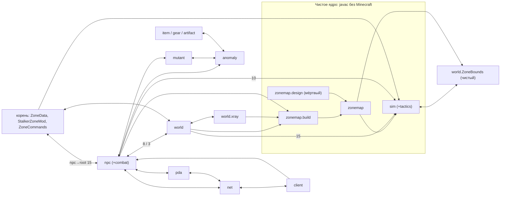

# 01. Технический аудит кода (T1)

## 0. Шапка
| Поле | Значение |
|---|---|
| Роль | `opus-lead-dev`, Lead Developer команды «Аудит» |
| Модель | Opus 5.5 (`claude-opus-5-5`) |
| Дата | 13.11.2026 |
| Коммит | `7aa3e12` (main, 07.11.2026 13:54, PR #117) |
| Режим | только чтение кода и истории; production code не менялся |

**Как читать.** Пометка **[код]** значит «проверено по коду или запуском», **[предп.]** — предположение с обоснованием. Пути даны от `src/main/java/ru/stalkerzone/`, если не указано иное. Замеры сделаны на ПК пользователя (JDK 17.0.20) классами из чистого набора тестов. Временные файлы лежат в scratchpad сессии, в репозиторий не попали.

**Объём кода [код].** 212 классов, 36 744 строки в `src/main/java`. 78 тестов `*Test.java` и 6 868 строк в `src/test/java`. 160 коммитов: Grilik — 66, github-actions (конвейер) — 53, Claude — 41.

---

## 1. Карта кода

Владелец указан по границе из `docs/claude/02-prompts.md:32`. «Строитель» отвечает за `zonemap/build/*`, кроме `Site.java` и `Prefabs.java`, а также за `tools/prefab/*` и `docs/kordon_objects/*`. Всё остальное — «Программист».

| Пакет | Файлов / строк | Назначение | Ключевые классы | Владелец |
|---|---|---|---|---|
| корень | 4 / 966 | вход мода, тик, команды, сохранение мира, сторож | `StalkerZoneMod`, `ZoneData` (SavedData), `ZoneCommands` (673), `ServerWatchdog` | Программист |
| `sim` | 52 / 10 454 | чистая симуляция: экономика, фракции, люди, логова, контракты, сохранение | `Simulation` (2 966), `ContractBoard` (771), `Logistics` (716), `People` (632), `KordonScenario`, `KordonBalance`, `Ledger`, `PdaSnapshot`, `BaseSnapshot` | Программист |
| `sim/tactics` | 4 / 300 | чистые алгоритмы боя | `CoverFinder`, `Accuracy`, `Morale`, `SquadOrders` | Программист |
| `zonemap` | 7 / 717 | общие интерфейсы сборщиков и старая процедурная карта | `BlockSink`, `Features`, `KillZone`, `RoadNet`; мёртвые `ZoneMap`, `Geo`, `Region` | Программист |
| `zonemap/build` | 19 / 6 635 | площадки и сборщики построек по обмерам | `Site`, `Prefabs` (механизм); `KordonVillage`, `KordonBunker`, `KordonSouthPost`, `KordonATP`, `KordonElevator`, `KordonTunnel`, `KordonWagon`, `KordonRoadBridge`, `KordonDump`; старые `Buildings` (992), `Structures` (564) | Строитель; `Site`, `Prefabs` — Программист |
| `zonemap/design` | 2 / 364 | старые процедурные дизайны | `CordonDesign`, `WorldDesign` | никто (мёртвый код) |
| `world` | 22 / 4 203 | события мира, граница, декор, лагеря, ориентиры, точки уровня | `ZoneWorld` (ChunkEvent.Load), `WorldDecorator`, `StructureManager`, `Camp` (593), `Landmarks` (694), `ZoneMapPlacer`, `LevelPoints`, `ZoneBounds` (чистый) | Программист |
| `world/xray` | 8 / 1 173 | перенос уровня `.szl` 1:1 | `LevelRegion` (чистый), `LevelRegions`, `XrayPlacer`, `XrayTerrain`, `PrefabLayer`, `HouseBuilder` | Программист (по `.clinerules` — только по отдельной карточке) |
| `npc` | 22 / 3 721 | NPC-сталкеры, отражение симуляции, торговля, караваны | `StalkerEntity` (746), `NpcManager` (512), `TraderWindow`, `TradeService`, `CaravanManager`, `PlayerFaction`, `WorkScheduleGoal`, `ModEvents` | Программист |
| `npc/combat` | 4 / 509 | бой NPC в мире | `TacticalCombatGoal`, `WorldGrid` (адаптер `CoverFinder.Grid`), `FleeGoal` | Программист |
| `mutant` | 5 / 659 | мутанты и логова в мире | `MutantEntity`, `MutantManager`, `MutantType` | Программист |
| `anomaly` | 5 / 1 119 | аномалии, артефакты, выброс, пси-поле | `AnomalyManager`, `EmissionEvent`, `Artifacts`, `PsiField` | Программист |
| `artifact` | 4 / 456 | артефакты и пояс | `ArtifactDef` (чистый), `Belt` | Программист |
| `gear` | 10 / 740 | вес, рюкзаки, костюмы | `Carry`, `Weight`, `TaczWeight` (чистый) | Программист |
| `item`, `block` | 8 / 383; 10 / 733 | предметы и блоки (341 blockstate) | `ModItems`, `ModBlocks`, `ObjPropBlock` (`safeSet`, `rawSet`, `worldgen`) | Программист |
| `pda`, `net`, `client` | 4 / 500; 1 / 229; 12 / 1 472 | КПК, 5 сетевых пакетов, экраны | `PdaService`, `Net`, `PdaScreen`, `TraderScreen`, `PdaModel` (чистый) | Программист |
| `compat` | 6 / 936 | TaCZ через отражение, `compat.json` | `Tacz`, `GunQuality`, `GunPackInstaller`, `CompatConfig` | Программист |
| `lab`, `survival` | 1 / 288; 2 / 187 | лаборатории (сценарий `zone`), радиация и нужды игрока | `LabManager`, `Radiation`, `PlayerNeeds` | Программист |

**Неоднозначности владения [код].**
- `zonemap/build/Framed.java` написал «Программист» в П-04 (#71). По правилу файл попадает в зону «Строителя».
- Чистые классы лежат в пакетах с Minecraft: `world/ZoneBounds`, `world/xray/LevelRegion`, `client/PdaModel`, `artifact/ArtifactDef`, `gear/TaczWeight`. `LevelRegion` и `PdaModel` в чистый набор тестов не входят вовсе, поэтому `LogLinesTest` проверяет `LevelRegion` поиском по тексту исходника.

---

## 2. Границы и чистота

### 2.1 Правило «`sim` и `zonemap` без Minecraft»
- **Соблюдается [код].** Поиск `net.minecraft`, `net.minecraftforge`, `com.mojang`, `org.slf4j` в `sim/` и `zonemap/` ничего не нашёл.
- **Единственный выход наружу — `world.ZoneBounds` [код].** Его импортируют 6 файлов: `sim/Lair`, `sim/LairTerritory`, `sim/PdaSnapshot`, `sim/Psi`, `sim/Simulation`, `zonemap/RoadNet`. Сам `ZoneBounds` импортирует `sim.Node`, так что получается цикл пакетов `sim ↔ world` через один чистый класс.
- **Как правило обеспечивается [код].** Отдельной проверки нет. CI компилирует `sim`, `zonemap` и три файла простым `javac` без Minecraft в classpath (`.github/workflows/build.yml:20-27`), и любой импорт Minecraft ломает компиляцию. Обратное направление не контролируется: `sim` может тянуть чистые классы других пакетов, если их дописать в список.

### 2.2 Три копии списка исходников расходятся
| Где | Состав | Состояние |
|---|---|---|
| `tools/ci/test_sources.sh:5-9` (CI и конвейер, `tools/conveyor/check.sh:10`) | `sim`, `zonemap`, `ZoneBounds`, `ArtifactDef`, `TaczWeight`, все тесты | **компилируется** [код, javac: 0 ошибок] |
| `tools/simtest.ps1:9-13` (тесты на Windows по `.clinerules`) | без `gear/TaczWeight.java` | **не компилируется** [код, javac]: `TaczWeightTest`, `MachineGunnerTest` — «package ru.stalkerzone.gear does not exist». Скрипт падает целиком на шаге «Компиляция не прошла». |
| `.claude/skills/stalkerzone-dev/SKILL.md`, раздел «Тесты симуляции» | без `TaczWeight` | та же ошибка [код] |

`TaczWeight` попал в `test_sources.sh` с П-13 (#80). Копию в `simtest.ps1` и в навыке не обновили. Заголовок `test_sources.sh` при этом называет себя «один список на CI и конвейер».

### 2.3 Граф зависимостей пакетов
Ребро означает ссылку из файлов пакета, включая полные имена `ru.stalkerzone.X.Y` в коде. На подписи — число файлов-источников [код, скрипт по исходникам]. Двойная стрелка — цикл.

**Циклы [код].**
- `sim ↔ world` и `zonemap → world` идут только через `ZoneBounds`.
- Игровая сторона — один сплетённый модуль: `npc ↔ world`, `npc ↔ mutant`, `npc ↔ anomaly`, `npc ↔ pda`, `npc ↔ net`, `net ↔ client`, `net ↔ pda`, `mutant ↔ anomaly`, `item ↔ gear`, `item ↔ anomaly`, `artifact ↔ gear`, `compat ↔ mutant`, `world ↔ world.xray`.
- Центр — корень: `ZoneData.get(server)` вызывается в 72 местах.

**Вывод.** Чистое ядро отделено хорошо. Вне ядра модульных границ нет: доступ к состоянию идёт через глобальный `ZoneData.get(...)` и статические менеджеры.

---

## 3. Интеграция симуляция ↔ мир ↔ NPC

### 3.1 Тик
`StalkerZoneMod.onServerTick` (`StalkerZoneMod.java:62-106`), фаза END [код]:
- **Раз в 20 тиков (`:67-79`):** `StructureManager`, `ZoneMapPlacer`, `NpcManager`, `MutantManager`, `LabManager`, `LandmarkManager`, `ZombieManager`, `MeetingManager`, `CaravanManager`, `BridgePost`; раз в 40 — `PsiField`.
- **Каждый тик (`:81-88`):** `LabManager.tickDownloads`, `AnomalyManager`, `Artifacts`, `ZoneLifeService`, `Perimeter`, `Reputation`, `Hermits`, `EmissionEvent`. Большинство сами проверяют `t % N` и пустой список игроков.
- **День симуляции:** раз в `TICKS_PER_SIM_DAY = 6000` тиков (`:20`, «позже вынесем в конфиг») — `sim.step()` (`:94`), `ZoneLifeService.daily`, при необходимости `EmissionEvent.start`, затем `sim.audit()`. Ошибка аудита пишется в лог один раз за запуск (`:100-104`).
- **Замер [код]** на Кордоне, 200 дней подряд в одном JVM сразу после `Scenarios.create`, `System.nanoTime` вокруг каждого `step()`, без отдельного прогрева: `step` в среднем 1,4 мс, максимум 60 мс (прогрев JIT). QA повторил своей программой: 0,14–0,91 мс на шаг, сохранение 8,2 мс. Цифры плывут с прогревом, порядок величины одинаковый. `save` занимает 10 мс и даёт около 95 тыс. символов Base64, `load` — 13 мс, `audit` чистый. Симуляция серверный тик не нагружает.

### 3.2 Сохранение
- `ZoneData` (`ZoneData.java`) — `SavedData` `stalkerzone_sim`. Внутри байты `sim.save()`, а рядом своё состояние мира: `built`, `campY`, `rendered`, `hidden`, `life`.
- **Версия формата 22 [код]** (`sim/Simulation.java:2609`). Чтение принимает версии 3–22 (`:2771`).
- **Сохранение старше v22 для Кордона молча выбрасывается [код].** `Simulation.load` возвращает новую симуляцию с тем же сидом (`:2778-2786`), без строки в лог (в `sim` логгера нет), а `ZoneData` об этом не знает. Версию поднимали четыре раза за 17 часов: v19 (#88, 06.11 18:43), v20 (#90, 18:59), v21 (#102, 07.11 08:28), v22 (#111, 11:19). Каждый раз симуляция существующего мира начиналась заново.
- **Состояние мира при этом не сбрасывается [код]:** `built`, `rendered`, `campY`, `hidden`, `life` остаются (`ZoneData.java:41-58`). Это двойной источник правды: мир помнит то, чего симуляция уже не знает. Насколько это заметно в игре — **[предп.]**, не проверялось.
- **Позиционный бинарный формат:** порядок узлов и фракций фиксирован, поэтому правило «узлы только в конец» верное.

**Enum-ы, сохраняемые по номеру [код].** Навык называет четыре (AnomalyType, LairKind, MutantType, ArtifactDef). В коде их больше:

| Enum | Где читается |
|---|---|
| `Phase`, `Goal`, `LairKind`, `BuildingType`, `AnomalyType` | `Simulation.java:2814, 2825, 2849, 2859, 2872, 2935` |
| `Contract.Type`, `Contract.Status`, индекс `Good.ALL` | `Contract.java:132, 136, 140, 147` |
| `Convoy.Kind` | `Logistics.java:704` |
| `Person.Cls`, `Person.Role` | `Person.java:95-96` |
| `MutantType` | в NBT сущности (`TAG_KIND`) |
| `ArtifactDef` | индекс в `ZoneData.hidden` |

Порядок закреплён тестом только у `ArtifactDef`: «прежние 8 артефактов на своих номерах» (`src/test/java/ArtifactTest.java:10`). Для остальных enum-ов такого теста нет [код]: поиск `ordinal() ==` по тестам пуст. Сохранение и загрузку тесты проверяют в одной версии кода (`SimDeterminismTest` и др.). Образца сохранения прошлой версии нет **[предп.]**, по поиску.

**Ещё в сохранении [код].**
- `Good.readCount` — статическое изменяемое поле, которое `load` переключает на время чтения (`Simulation.java:2788, 2963`).
- Ошибка записи `life` проглатывается (`ZoneData.java:76`), повреждённый `life` молча сбрасывается (`:55`).

### 3.3 Закон сохранения (Ledger)
- Сделки игрока идут через симуляцию: `playerBuy` и `playerSell` пишут `ledger.exported/imported` и `moneyMinted/moneyBurned` (`Simulation.java:825-860`) [код]. Пошлина моста — через `sim.playerBribe` (`world/BridgePost.java:194`).
- **Нарушение: деньги курьера пропадают без учёта [код].** `npc/CaravanManager.caravanNpcKilled` (`:166-177`) при гибели курьера в мире списывает товары через `ledger.destroyed` (`:173`), но обнуляет `cv.cargo.money` без `ledger.moneyBurned` (`:176`). Деньги караванов входят в аудит (`Simulation.java:2559-2561`), а курьер везёт наличные (`Simulation.java:2058`, `moveMoney(... courierBudget)`). После убийства курьера `sim.audit()` даст «Деньги: ожидали …», и `StalkerZoneMod` один раз напишет ошибку в лог. Правильный образец — `Logistics.java:618-619`.
- Это единственное место, где игровой код пишет поля `ledger` напрямую [код, поиск по `ledger.` вне `sim`].
- Временная связь [код]: `PlayerFaction.applyTrade` и `resetTrade` меняют `sim.playerBuyFactor/playerSellFactor` вокруг каждой сделки (`npc/PlayerFaction.java:186-196`, `npc/TradeService.java:103-106`).

### 3.4 NPC как отражение симуляции
- `NpcManager.tick` раз в секунду обходит узлы в радиусе 110 блоков от игроков. `ensure` (`npc/NpcManager.java:86-150`) держит число `StalkerEntity` равным `NodePopulation.number`. Лишних удаляет `discard()` без последствий для симуляции, а гибель в бою уменьшает фракцию [код].
- Именные люди (`sim.people`) назначаются сущностям через `assignPerson` (`:154-181`) [код].
- NPC постоянные: `setPersistenceRequired`, `removeWhenFarAway = false` (`npc/StalkerEntity.java:71, 704`). Вдали от игроков они лежат в чанках и сверяются при следующем подходе.
- Сущность берёт симуляцию через `getServer()` → `ZoneData.get` (`StalkerEntity.java:309-312`). На клиенте `getServer()` равен null, поэтому гонки клиент↔сервер нет [код].
- **По данным `sonnet-engineer` (T2, `02-systems-audit.md`), перепроверено [код]:** узлы 22 и 23 (заставы туннеля) не имеют ни `Site` (`Prefabs.java:64-86`), ни записи в `points/l01_escape.json` (там узлы 0–18), поэтому `spawnAtLevelPoint` возвращает null и NPC там не появляются. Уровни построек 0–3 в мире не отражаются: площадки строятся один раз с `PrefabLayer.WORLDGEN_LEVEL = 1` (`world/xray/PrefabLayer.java:20`), а места NPC берутся при `Prefabs.POINT_LEVEL = 1`. Поэтому место пулемётчика «mg» с уровня 2 недостижимо.

### 3.5 Команды, конвои, караваны
- `sim.Command` (sealed: Trade, Attack, Production, Stance) — решения `FactionBrain`. Проверяет и исполняет их `Simulation`. Хороший рубеж, в мир не выходит [код].
- `Convoy` (`Logistics`) — снабжение между складами. Существует только в симуляции, в мире не показывается [код: вне `sim` не используется].
- `Caravan` — торговые караваны. В мире их отряды появляются рядом с игроком (`CaravanManager`, ≤ 24 NPC) в радиусе 48 блоков от точки дороги. Получаются два параллельных транспорта с разной судьбой в мире.

### 3.6 Снимки для клиента и сеть
- `net/Net.java`: канал версии `"2"`, пять пакетов (`:27-38`). `PdaSnapshot` и `EmissionPhase` идут на клиент, `PdaAction` и `TraderAction` — на сервер, `TraderView` — на клиент [код].
- **Сервер авторитетен в торговле [код].** `TraderWindow.handle` проверяет сущность, что это торговец, что он жив, дистанцию `REACH = 8`, жизнь игрока и ограничивает `qty` до 10 000 (`npc/TraderWindow.java:134-144`). Индексы проверяются в `buy` и `sell` (`:273, 285`).
- **Протокол КПК — текст с однобуквенными тегами [код].** `sim/PdaSnapshot` пишет строки, `client/PdaModel.parse` (`:53-90`) их разбирает, общей схемы нет. Строки `Q` (отряды в пути) и `U` (население узлов) из карточки 051 (#89) пишутся (`sim/PdaSnapshot.java:96, 107`), но `PdaModel` их не разбирает, и на экране их нет. Это ожидаемо: экран карты П-08 ещё не сделан. Но теста «сервер пишет — клиент читает» нет, хотя `PdaModel` — чистый класс и его можно тестировать.
- `sim/BaseSnapshot` (#96) не вызывается нигде, кроме теста: это данные для ещё не сделанного пульта П-09 [код].

### 3.7 Карточки, которые дали API без вызова из игры [код]
- **061 `LairTerritory` (#112):** вне себя используется только в тестах. В мире мутанты держатся радиусом 30/40 вокруг логова (`mutant/MutantManager.java:131, 161`).
- **064 «грызня видов» (#110):** `Simulation.mutantKilledByMutant` (`:994`) и `LairTerritory.hostile` не вызываются. Цели мутантов — игрок, сталкер, обидчик и мобы (`mutant/MutantEntity.java:81-83`), вражды видов нет.

Причина техническая. Паспорт карточки конвейера v2 разрешает менять только перечисленные файлы, а «готово» означает «тест карточки зелёный» (`tools/conveyor/conveyor.sh`, шаг 3). Если в карточке только `sim/*`, исполнитель не может подключить её к игре.

### 3.8 Слабые места интеграции
| Слабое место | Где | Пометка |
|---|---|---|
| Узлы ищутся по русскому имени («Бар», «Радар»…): 17 мест сравнивают `.name.equals(...)`, имена заданы строковыми литералами в таблицах (у QA — 39 литералов) | `npc/Reputation.java:105`, `npc/Hermits.java:45`, `world/LandmarkManager.java` и др. | [код] |
| Номера узлов дублируются: `Prefabs.NODE_*` и число `20` в `Prefabs.java:44, 76` против констант `KordonScenario.java:16-30` | `zonemap/build/Prefabs.java` | [код] |
| Координаты узлов в трёх местах: `KordonScenario.COORDS` (единицы ×10, точность ±5 блоков, `:41-48`), `points/l01_escape.json` и его побайтная копия `kordon_points.json`; класс `world/KordonPoints` мёртв | `data/stalkerzone/` | [код, `cmp`] |
| Сценарий выбирается системным свойством на всю JVM (`sim/Scenarios.java:22`), а в сохранении — свой `scenario`. Мир, биомы и уровни кэшируют узлы `Scenarios.create(0)` статически. | `world/ZoneWorld.java:33`, `world/ZoneBiomes.java:29`, `world/WorldDecorator.java:31`, `world/xray/LevelRegions.java:22` | [код] |
| Четыре кэша результатов `Prefabs` с разной логикой запасного значения | `NpcManager.PREFAB_POINTS` (без уровня y = 75, кэшируется навсегда), `LevelPoints.PREFAB` (без уровня — пусто), `StalkerEntity.KILL_ZONES`, `PrefabLayer.CACHE` | [код] |
| Три входа в торговлю с одной проверкой «8 блоков» | `TraderWindow` (П-07), Shift+ПКМ (`StalkerEntity.java:~588-594`), `/zone sell`, `/zone buy`, `/zone repair` (`ZoneCommands.java:418-499`) | [код] |

---

## 4. Генерация мира

### 4.1 Конвейер генерации
1. **Загрузка `.szl` [код].** `LevelRegions.all()` (`world/xray/LevelRegions.java:51-82`) лениво, один раз за JVM и под `synchronized`, читает `<игра>/stalkerzone/levels/<id>.szl`. Путь задаёт системное свойство из конструктора мода (`StalkerZoneMod.java:34`), запасной вариант — ресурсы мода. Для Кордона берётся только `l01_escape` (`:22`). Пишется строка лога «уровень … загружен» или «не найден» (после #69). Первый вызов возможен из потока генерации через `XrayTerrain` **[предп.]**; это безопасно за счёт `synchronized` и `volatile`.
2. **Площадки до генерации чанков [код].** `LevelRegion.load` сразу вызывает `shapeSites()` (`world/xray/LevelRegion.java:50, 81-93`). `Prefabs.shape` → `Site.apply` правят карту высот ×8 (плато AUTO — медиана, откосы, выемки) и убирают воду на плато. Объекты `Site` и `Plateau` лежат в `static final List SITES` (`zonemap/build/Prefabs.java:64`) и хранят вычисленную высоту в изменяемых полях (`Site.java:127-152`).
3. **Рельеф (потоки генерации) [код].** `XrayTerrain.compute` (`world/xray/XrayTerrain.java`) — плотность из карты высот уровня с плавным переходом `BLEND = 96` к шуму Зоны. `noise_settings/zone.json` ссылается на `stalkerzone:xray_terrain`, пресет мира — `world_preset/zone.json`.
4. **Декор при `ChunkEvent.Load` (серверный поток) [код].** `ZoneWorld.Events.onChunkLoad` (`world/ZoneWorld.java:74-82`) оборачивает в `ObjPropBlock.worldgen(...)`:
   - `WorldDecorator.decorate`: метка `REINFORCED_DEEPSLATE` в нижнем углу чанка означает «уже сделано» (`:47-49`);
   - внутри уровня — `XrayPlacer.place` (`world/xray/XrayPlacer.java:133-181`): поправка поверхности ±3 блока, вода, вырезы помещений (кроме площадок), воксели построек без областей `CLEAR`, двери, откосы, `HouseBuilder`, заборы, `PrefabLayer.place` (`:174`), деревья с кронами соседних чанков; затем `LinkRoads.decorate`;
   - `WallBuilder.build` на чанках границы Зоны.
5. **Сборщики [код].** `PrefabLayer.of` при первом чанке уровня строит **все** площадки сразу (`Prefabs.build`) и раскладывает блоки по чанкам (`world/xray/PrefabLayer.java:27-42`). Замер (`Prefabs.build("l01_escape", ровная земля 84, уровень 1)` три раза подряд, без FramedBlocks): 121 625 блоков, 244 разных состояния, первый прогон 181 мс, дальше 34–42 мс. У QA — 149 мс и 29–61 мс, блоки и состояния совпали точно. Это разовая пауза, не зависание.
6. **Строка состояния → блок [код].** `ZoneMapPlacer.state` (`world/ZoneMapPlacer.java:39-49`) парсит строку сборщика. При ошибке разбора возвращает `AIR` **без записи в лог** (`:45-46`). Это известно как открытая проблема 3, но строки в логе до сих пор нет.
7. **Декор узла «при подходе игрока» [код].** `StructureManager.levelNodeDecoration` (`world/StructureManager.java:53-82`) работает в радиусе 110 блоков. Он проверяет `hasChunk` в ±48 от центра и под каждой точкой (`decorLoaded`, `:85-92`, исправление #67), потом вызывает `Camp.placeLevelDecor` и `RadioactiveSpots` через обычный `level.setBlock`.

### 4.2 Что синхронно и что может повесить сервер
Общий корень зависаний #64, #67, #117 **[код]**. Декор уровня ставится на серверном потоке внутри обработчика `ChunkEvent.Load`, пока чанк ещё переводится в «полный». Любой вызов, который через `Level` спрашивает соседний или этот же чанк, заставляет серверный поток ждать чанк, а тот ждёт серверный поток.

| История | Что было | Чем закрыто |
|---|---|---|
| #64 (05.11) | тяжёлые сборщики АТП, элеватора, фермы, дальнего блокпоста, моста/туннеля при загрузке | 5 сборщиков отключены (классы оставлены) |
| #67 (05.11) | декор узла 6 читал точки за ±48 → синхронная генерация чанка | `decorLoaded` + сторож `ServerWatchdog` |
| #117 (07.11) | рельсы туннеля (вернулся в П-23, #98): `LevelChunk.setBlockState` → `BaseRailBlock.onPlace` → соседний чанк | `ObjPropBlock.rawSet` пишет прямо в секцию, обновляет карты высот и свет, без `onPlace`; `ChunkLoadPlaceTest` по исходникам; `server_smoke.sh` грузит чанки 5 площадок |

**Остающиеся риски этого класса.**
- **[код]** `ObjPropBlock.safeSet` для **нового** блока с BlockEntity всё ещё вызывает ванильный `c.setBlockState` (`block/ObjPropBlock.java:86-87`), а значит и `onPlace`. Так ставятся формы FramedBlocks с NBT (`PrefabLayer.place`). Замер #77 проверял тик, а не безопасность загрузки. CI запускает сервер с FramedBlocks (`build.gradle`, `runtimeOnly framedblocks`), и проверка проходит. Риск низкий **[предп.]**.
- **[код]** `WallBuilder.build` заменяет блок с BlockEntity прямым `chunk.setBlockState(...)` (`world/WallBuilder.java:42`, карточка 027). Значит, срабатывает `onRemove` старого блока, а это тот путь «снятие BE лезет через Level», от которого защищает `safeSet` (комментарий `ObjPropBlock.java:73-74`). Сработает только на чанке границы с ульем или сундуком. Деревья без ульев (#63) делают это редким **[предп.]**.
- **[код]** Ветка жидкостей в `safeSet` (`ObjPropBlock.java:78-85`) пишет воду в секцию без обновления карт высот и света. `rawSet` делает это правильно и тоже не зовёт `onPlace`, так что ветка теперь лишняя и хуже. Возможные следствия — пятна света и неверная высота `MOTION_BLOCKING` над водой для `SpawnFinder.groundAt` **[предп.]**.
- **[код]** `SpawnFinder.groundAt` всегда вызывает `level.getChunk` (`world/SpawnFinder.java:12`), то есть синхронно генерирует чанк. Вызовы проверены: почти везде стоит `hasChunk`. Без проверки остались `CaravanManager.java:101` (точка ≤ 48 блоков от игрока, чанк загружен) и `EmissionEvent.java:243` (`level.getHeight` в 24–64 блоках от игрока). Риск низкий при обзоре ≥ 5 чанков **[предп.]**.
- **[код]** Админ-команды `/zone build`, `/zone construct` (`ZoneMapPlacer.build`, `ZoneCommands.java:654, 669`) читают и пишут блоки без проверки загрузки. Для отладки это допустимо.

**Стоимость декора на серверном потоке [предп.].** Каждый новый чанк уровня проходит `XrayPlacer.place` на серверном потоке, деревья соседей перебираются 9 раз. При обзоре 20 у пользователя это может давать просадки TPS при движении. CI этого не меряет: обзор 10, без игрока, только `forceload`. Нужен замер на реальном `.szl`.

### 4.3 Данные
- **[код]** `kordon_points.json` и `points/l01_escape.json` совпадают побайтно (`cmp`). Код читает второй через `LevelPoints`. `world/KordonPoints` (`RESOURCE = kordon_points.json`) ниоткуда не вызывается, первый файл читает только `AtpTest`.
- **[код]** Пресеты: `zone`, `zone_classic`, `zone_flat`, 17 биомов. 15 из них относятся к полной Зоне (сценарий `zone`) и для «Малого Кордона» не нужны.
- **По данным `sonnet-engineer`, не перепроверял:** `LevelPoints.readVec` → `onPlateau` трактует `v[0], v[2]` как x, z, а `BridgePost.region` читает через него четырёхэлементный `gate [x0,z0,x1,z1]`. Сейчас это безвредно: ни одна площадка не совпадает. Но это скрытая ловушка.

---

## 5. Производительность и устойчивость

- **Тик [код].** Тяжёлых операций каждый тик нет. `AnomalyManager.tick` каждый тик перебирает все аномалии × игроков и шлёт частицы `sendParticles` каждому игроку рядом, раз в 2–10 тиков на аномалию (`anomaly/AnomalyManager.java:186-215`). Это нагрузка на сеть при многих аномалиях рядом. Остальное прорежено (`t % N`) и выходит сразу, если игроков нет.
- **Сущности [код].** На узел не больше 12 (база), 6 (узел) или 4 (малая застава) человек (`sim/NodePopulation.java:12-16`). Караваны — ≤ 24 NPC. На логово — ≤ 6 мутантов (`sim/Lair.java:13`). Боевая сетка `WorldGrid` не читает незагруженные чанки (`npc/combat/WorldGrid.java:26`).
- **Block entities [документы].** Вывод #77: штаб с FramedBlocks — 256 BE, тик не изменился, граница около 2 000 BE на базу (`00-start-here.md`, журнал 06.11 16:45). По коду не перепроверял.
- **Сторож [код].** `ServerWatchdog` — поток-демон. Если тик стоит больше 10 с, он пишет стек серверного потока и активных потоков генерации. Паузу одиночной игры учитывает через `ClientEmission`, выключается в `compat.json`. Сработал 07.11 и дал стек для #117, так что инструмент работает.
- **Статическое состояние не сбрасывается между мирами [код].** Подписчиков на остановку и запуск сервера два: `ServerWatchdog` и `ZoneWorld`. Ни один не очищает менеджеры. В одиночной игре при выходе в меню и входе в другой мир переживают:
  - `EmissionEvent.ticksLeft`, `scheduled`, `redFade` (`anomaly/EmissionEvent.java:53-58`): начатый выброс продолжится в другом мире;
  - `ZoneMapPlacer.SITES` (`world/ZoneMapPlacer.java:159`): держит ссылку на старый `ServerLevel`. Это утечка, а при незаконченной стройке ещё и запись в закрытый мир;
  - `CaravanManager.spawned` (`:39`), `MutantManager.COOLDOWN` (`:37`), `LabManager.SESSIONS` (`:48`), `MeetingManager.NOTIFIED` (`:34`), кэши `AnomalyManager`.

  Последствия **[предп.]**: проявятся редко, но их трудно отлаживать. Выброс к тому же не сохраняется в `ZoneData`.
- **Клиент и сервер [код].**
  - Клиентский код отделён правильно. Все подписчики `client/*` и `npc/ModEvents.Client` помечены `Dist.CLIENT`. Сетевые обработчики зовут клиент через `DistExecutor.unsafeRunWhenOn` (`net/Net.java:65, 125, 202`).
  - `ZonePacks::addPacks` подключён в общем конструкторе (`StalkerZoneMod.java:41`), но использует только общие классы `net.minecraft.server.packs`. Это безопасно.
  - `npc/StalkerRenderer` — клиентский класс в общем пакете. Вызывается только из `ModEvents.Client`, но здесь легко ошибиться.
  - Задание `server` в CI поднимает выделенный сервер, поэтому падение на загрузке клиентских классов при старте CI ловит.
- **Потоки [код].** Ленивые кэши (`LevelRegions`, `ZoneBiomes.init`, `WorldDecorator.centers`, `PrefabLayer.of`) защищены `synchronized` или `volatile`. `ZoneMapPlacer.CACHE` — обычный `HashMap`. Он вызывается только с серверного потока **[предп.]**, по найденным вызовам.

---

## 6. Зависимости и сборка

- **Forge [код].** Сборка идёт на 47.3.0 (`gradle.properties`), у игрока 47.4.28. В `mods.toml`: `loaderVersion [47,)`, `forge [47,)`, `minecraft [1.20.1,1.21)`. Версии совместимы, но CI проверяет не ту версию, что у игрока. Риск низкий **[предп.]**. Миксинов нет, ForgeGradle `[6.0,6.2)`, маппинги official 1.20.1.
- **TaCZ [код].**
  - Необязательная зависимость `[1.1.0,)`. Все вызовы идут через отражение (`compat/Tacz.java:93-98`, `compat/GunQuality.java:123-129`), при сбое — `warn` и работа без оружия.
  - `GunPackInstaller` в конструкторе мода копирует `szguns_pack` в `<игра>/tacz/stalkerzone_guns` и переписывает только при смене отпечатка.
  - В сборку TaCZ попадает, только если есть `libs/tacz-1.20.1.jar`, а `libs/` в `.gitignore`. **В CI путь TaCZ не исполняется никогда** [код]. По данным `sonnet-engineer`, скрипт получения jar лежит вне репозитория (`C:\MineStalker`).
- **FramedBlocks [код].** Диапазон `[9.4,)`, `runtimeOnly` из Modrinth 9.4.3, скачивается при каждой сборке CI. Флаг `zonemap.build.Framed.loaded` ставится в конструкторе (`StalkerZoneMod.java:44`). Сборщики выдают NBT-строки или ванильный запасной вариант. В CI-сервере FramedBlocks есть.
- **Ресурсы [код].** `assets` занимают около 30 МБ (модели 26 МБ, 341 blockstate), `szguns_pack` — 4,2 МБ, `resourcepacks/stalker_textures` — 0,5 МБ. Данные GSC не попадают: `*.szl` в `.gitignore`. По данным `sonnet-engineer`, в индексе git лежат `bin/main`, `bin/test` (около 3 300 файлов) и логи в корне. В `.gitignore` они есть, но были добавлены раньше.
- **CI `build.yml` [код].**
  - Чистые тесты (`:20-31`) идут без `timeout` и без `-Dstdout.encoding`. Оболочка Actions работает как `bash -e`, поэтому цикл останавливается **на первом** упавшем тесте, и остальные не прогоняются. В `check.sh` это сделано правильно: все тесты, список упавших, `timeout 600`.
  - Затем `gradlew build` и релиз `nightly`, который удаляется и создаётся заново (`:44-55`). Между удалением и созданием ссылка для игрока не работает.
  - **Задание `server` не связано с релизом:** у него нет `needs`, а релиз делает задание `build`. `nightly` выходит, даже если сервер завис, то есть ровно в случае класса #117. К тому же `concurrency cancel-in-progress: true` у `server` отменяет проверку предыдущего коммита main при быстрых слияниях.
- **`server_smoke.sh` [код].**
  - Синтетический уровень `fake_szl.py`, обзор 10, без игрока. Скрипт грузит деревню и 5 площадок через `forceload`, ждёт 60 с и проверяет TPS ≥ 15, молчание сторожа, «Saving worlds» и строку уровня.
  - Без игрока все менеджеры «рядом с игроком» сразу выходят: NPC, аномалии, декор узлов, мутанты, караваны.
  - День симуляции (6 000 тиков = 5 мин) за время проверки, скорее всего, не наступает **[предп.]**.
- **Конвейер [код].**
  - `conveyor.yml` и `tools/conveyor/conveyor.sh`: одна попытка Cline с дешёвой моделью, ≤ 15 мин и ≤ $0,30. «Готово» = тест карточки, все тесты и `gradlew build`. Сервер запускается уже после создания PR (`gh workflow run build.yml`).
  - Исполнитель `cline -y` запускается в шаге, где в окружении лежат `GH_TOKEN` (права `contents`, `pull-requests`, `actions`: write), `OPENROUTER_API_KEY` и токены Telegram. Агент их наследует. Защита main от прямого пуша из кода не видна **[предп.]**: настройки репозитория не проверялись.
  - Задание `mark` пушит статус карточки прямо в main, с `git reset --hard` в цикле повторов. Это допустимо, но это прямой пуш бота в main.
- **Тесты по тексту исходников [код].** `ChunkLoadPlaceTest`, `FenceTrapdoorTest`, `FramedTest`, `LogLinesTest` ищут подстроки в `.java`. `ChecklistTest`, `ConveyorTest`, `HandoffTest` проверяют документы и инструменты. Такие проверки хрупкие: они ломаются от переименования и не проверяют поведение. Но для кода с Minecraft это единственная проверка без игры.
- **Дополнение по данным `sonnet-qa` (T3).** (а) Перепроверено [код]: на ПК пользователя `core.autocrlf=true`, рабочие копии `.java` в CRLF (`git ls-files --eol`). `FramedTest` ищет в исходнике подстроку «перевод строки, 4 пробела, `}`, перевод строки» (`src/test/java/FramedTest.java:43`) и на Windows падает, хотя в CI (LF) зелёный. Это общий риск всех тестов по тексту исходников. (б) Перепроверено [код]: `server_smoke.sh` смотрит лог на `Exception`/`ERROR` только при провале (`:11`) и не вызывает аудит экономики, поэтому исключения при успешном прогоне и расхождение Ledger проверку не роняют. (в) Не перепроверял: по подсчёту QA 12 из 38 прогонов main после #80 отменены из-за `cancel-in-progress` у `server`.

---

## 7. Качество кода и техдолг

| # | Проблема | Где | Серьёзность | Пометка |
|---|---|---|---|---|
| 1 | Нарушение закона сохранения: деньги курьера пропадают без `moneyBurned` | `npc/CaravanManager.java:173-176` | высокая | [код] |
| 2 | `nightly` выходит без проверки сервера (`server` без `needs`) | `.github/workflows/build.yml` | высокая | [код] |
| 3 | Старое сохранение Кордона молча выбрасывается; `ZoneData` (built, rendered, hidden, life) не сбрасывается вместе с ним; в лог ничего | `sim/Simulation.java:2778-2786`, `ZoneData.java:41-58` | высокая | [код]; последствия — [предп.] |
| 4 | 11 enum-ов и индекс `Good` сохраняются по номеру; правило в навыке называет 4; тест порядка есть только у `ArtifactDef` | см. 3.2 | высокая | [код] |
| 5 | God-класс `Simulation`: 2 966 строк, около 78 публичных методов (76 по моей регулярке, 78–79 у QA), 16 разделов (сюжет, аномалии, постройки, стройка, сделки, проходы, экономика, цены, командование, караваны, война, аудит, сохранение ~360 строк). `.clinerules:57` пишет «~2100» | `sim/Simulation.java` | высокая | [код] |
| 6 | Карточки 061 и 064 «готовы», но в игре не работают | см. 3.7 | средняя | [код] |
| 7 | `tools/simtest.ps1` и команда в SKILL.md не компилируются (нет `TaczWeight`) | `tools/simtest.ps1:9-13` | средняя | [код, javac] |
| 8 | Статическое состояние переживает смену мира (выброс, стройка с `ServerLevel`, кэши) | см. раздел 5 | средняя | [код]; проявление — [предп.] |
| 9 | Ошибки молча превращаются в воздух или сброс: `ZoneMapPlacer.state` → AIR без лога; `ZoneData` проглатывает ошибку записи `life` | `world/ZoneMapPlacer.java:45`, `ZoneData.java:55, 76` | средняя | [код] |
| 10 | `WallBuilder` снимает BlockEntity при загрузке чанка в обход `safeSet` | `world/WallBuilder.java:42` | средняя | [код]; срабатывание — [предп.] |
| 11 | Узлы ищутся по строке имени (17 сравнений, десятки литералов) | см. 3.8 | средняя | [код] |
| 12 | Мёртвый код: `KordonFarm`, `KordonFarPost`, `KordonBridgeTunnel` (отключены с #64, около 1 000 строк); `zonemap/design/*`, `ZoneMap`, `Geo`, `Region` (старая процедурная карта, только тесты и `MapPreview`); `world/KordonPoints` и копия `kordon_points.json`; `SimMain` (CLI) | `zonemap/*`, `world/*` | низкая | [код, поиск ссылок] |
| 13 | Код, доступный только из админ-команд: `Buildings` (992 строки) и почти весь `Structures` — только через `/zone build` и `/zone construct`; в игре из `Structures` используется лишь `lairDen` | `ZoneCommands.java:654, 669`, `Prefabs.java:89` | низкая | [код] |
| 14 | Наследие сценария `zone`: `Landmarks` (694), `LandmarkManager`, `LabManager`, большая часть `WorldDecorator`, `Camp.buildGround/renderBuilding`, 15 биомов. На Кордоне с `.szl` не работает; без `.szl` включается процедурный запасной путь | `world/*`, `lab/*` | низкая | [код] |
| 15 | Ветка жидкостей в `safeSet` без карт высот и света | `block/ObjPropBlock.java:78-85` | низкая | [код]; эффект — [предп.] |
| 16 | Дубли: радиусы активности (`ACTIVE = 110` в трёх менеджерах, 72, 128), четыре кэша `Prefabs`, номера узлов в `Prefabs` и `KordonScenario`, три копии списка тестов | см. выше | низкая | [код] |
| 17 | `ZoneCommands`: блок `try/catch → «Команда только для игрока»` скопирован около 20 раз; около 60 подкоманд в одном `register` | `ZoneCommands.java` | низкая | [код] |
| 18 | Мелкие расхождения комментариев: «id узла + 1000» при коде `+ 10000` (`StructureManager.java:59-60`), и `forget()` не сбрасывает ключ декора; javadoc выброса стоит над `TraderView` (`net/Net.java:128-133`); раздел «логова мутантов» в `Simulation.java:811` пуст | разное | низкая | [код] |
| 19 | Мусор в индексе git: 3 319 файлов `bin/`, логи `build.log`, `javac.err`, `gitlog.txt`, `gs.txt`, `tail3.txt` в корне | корень репозитория | низкая | [код, `git ls-files`]; нашёл `sonnet-engineer` |
| 20 | Логирование: `System.out/err` вне `SimMain` нет (после #69); логгер есть в 11 классах; `sim` без логгера отдаёт строки наверх (`LevelRegion.sitesLog`), и это хороший образец | — | плюс | [код] |
| 21 | Магические числа: баланс собран в `KordonBalance` (хорошо), но в коде мира много литералов (`0.18 : 0.08` в `NpcManager.java:178`, `15L * parts` в `TraderWindow.java:238`, `TICKS_PER_SIM_DAY` «в конфиг позже») | разное | низкая | [код] |

---

## 8. Рекомендации к целевой архитектуре (вход для руководителя)

Приоритет — работающий «Малый Кордон» и интерфейсы из `04-interfaces.md`. Проект не переписывать.

1. **Закрепить чистое ядро как отдельный набор исходников.** Собрать `sim`, `zonemap` и чистые классы из пакетов с Minecraft (`ZoneBounds`, `LevelRegion` без логгера, `PdaModel`, `ArtifactDef`, `TaczWeight`) в ядро. Это может быть отдельный source set Gradle, а на первом шаге — просто перенос пакетов. Список исходников должен быть один, и `simtest.ps1` и навык должны читать его, а не копию. Добавить явную проверку «в ядре нет `net.minecraft`».
2. **Единый API записи при загрузке чанка.** Все записи из `ChunkEvent.Load` идут через один класс-«писатель чанка»: только свой чанк, без `Level`, с `rawSet` и для жидкостей, и отдельной безопасной веткой для BE. Тест по исходникам (обобщённый `ChunkLoadPlaceTest`) запрещает `ChunkAccess.setBlockState` в `world/**` вне этого класса. Закрыть `WallBuilder.java:42`. После «Малого Кордона» стоит обсудить перенос постановки уровня в шаг генерации (`Feature` или `applyBiomeDecoration` с `WorldGenRegion` на рабочих потоках). Это убирает весь класс зависаний #64, #67, #117, но это отдельная крупная задача.
3. **Шлюз «мир → симуляция».** Ввести узкий фасад событий и сделок: гибель человека или мутанта, гибель курьера, сделка, пошлина, контракт. Игровой код не пишет `ledger`, `cargo`, `playerBuyFactor` напрямую. Первым делом исправить `CaravanManager.java:173-176`. Тогда закон сохранения проверяется в чистых тестах фасада.
4. **Вынести сохранение из `Simulation`.** Отдельный кодек (сейчас около 360 строк) со **стабильными id** enum-ов вместо `ordinal` и тестом-эталоном: сохранение v22 лежит в `src/test/resources` и должно читаться. При сбросе по версии — строка в лог и согласованный сброс полей `ZoneData`.
5. **Делить `Simulation` постепенно, по месту работ.** Кандидаты по разделам: логова (включая `LairTerritory` и грызню видов, тут же подключить их к `MutantManager`), аномалии, сделки игрока, караваны, война и фазы. `Simulation` остаётся фасадом и порядком шагов `step()`. Уже вынесенные `Logistics`, `People`, `Politics`, `ContractBoard`, `Labs`, `GlobalMarket` — правильный образец.
6. **Жизненный цикл.** Один объект состояния на сервер, создаётся при старте и обнуляется при остановке. Туда переходят статические поля менеджеров: выброс, стройки, кэши, сессии. Фаза выброса сохраняется в `ZoneData`.
7. **Один источник данных об узлах.** Номер, имя, координаты и площадка хранятся в одном месте (`points/l01_escape.json` или `KordonScenario`), а остальные места проверяются тестом. Удалить `kordon_points.json` и `KordonPoints`. Поиск узла по имени заменить на роль или номер. Заставы туннеля 22 и 23 получают точки или площадку.
8. **Контракт протокола КПК и пульта.** Перенести `PdaModel` в ядро и добавить чистый тест «`PdaSnapshot.build` → `PdaModel.parse` не теряет строк». Он сразу покажет `Q` и `U`. Для П-08 и П-09 те же правила действуют для `BaseSnapshot`.
9. **CI как ворота.** Релиз `nightly` выпускать после `build` **и** `server` (`needs`). В цикле тестов нужны `timeout`, прогон всех тестов и список упавших, как в `check.sh`. Отмену `server` на main убрать. В паспорт карточки конвейера добавить обязательный пункт «где это вызывается в игре» или явную пометку «данные для П-xx».
10. **Оставить как есть:** чистая симуляция с тестами-`main`; конвейер сборщиков `BlockSink → Prefabs/Site → PrefabLayer` (одна функция сборщика даёт блоки, рабочие места и запретные полосы); сервер как авторитет в торговле; `ServerWatchdog`; пара `fake_szl.py` + `server_smoke.sh`; адаптер `CoverFinder.Grid` ↔ `WorldGrid` как образец «чистый алгоритм + тонкий слой Minecraft».

---

## 9. Открытые вопросы

1. **Сколько стоит `XrayPlacer.place` на серверном потоке** с настоящим `l01_escape.szl` при обзоре 20? Нужен профиль: в CI уровень синтетический, обзор 10, игрока нет.
2. **Шлёт ли Forge 47.x `ChunkEvent.Load` для ProtoChunk** при чтении с диска? От этого зависит, нужна ли ветка `safeSet` для не-`LevelChunk`. По коду мода это не установить.
3. **Безопасен ли `onPlace` у форм FramedBlocks при загрузке чанка** (путь `safeSet` → ванильный `setBlockState` для BE)? CI проходит, отдельной проверки нет.
4. **Что видит игрок после сброса симуляции по версии** на старом мире: лагеря и ключи `rendered` на месте, а владельцы и население новые. Нужна проверка в игре.
5. **Наступает ли день симуляции** за время `server_smoke.sh`? Без доступа к логам Actions это не проверить (по навыку, логи через прокси недоступны).
6. **Закрыт ли main от прямого пуша** (branch protection)? От этого зависит риск запуска агента с `GH_TOKEN` в окружении.
7. **Сценарий `kordon_war`** (карточка 054, #111) противоречит правилу `02-prompts.md:81` «отдельный сценарий не делать». Решение это пользователя или самовольство карточки, по коду не установить. Вопрос передан `sonnet-qa`.
8. **Открытая проблема 5 (высоты)** и размер `.szl` у пользователя: строка лога площадок теперь пишется логгером (#69), но подтверждения в документах после 06.11 нет.
