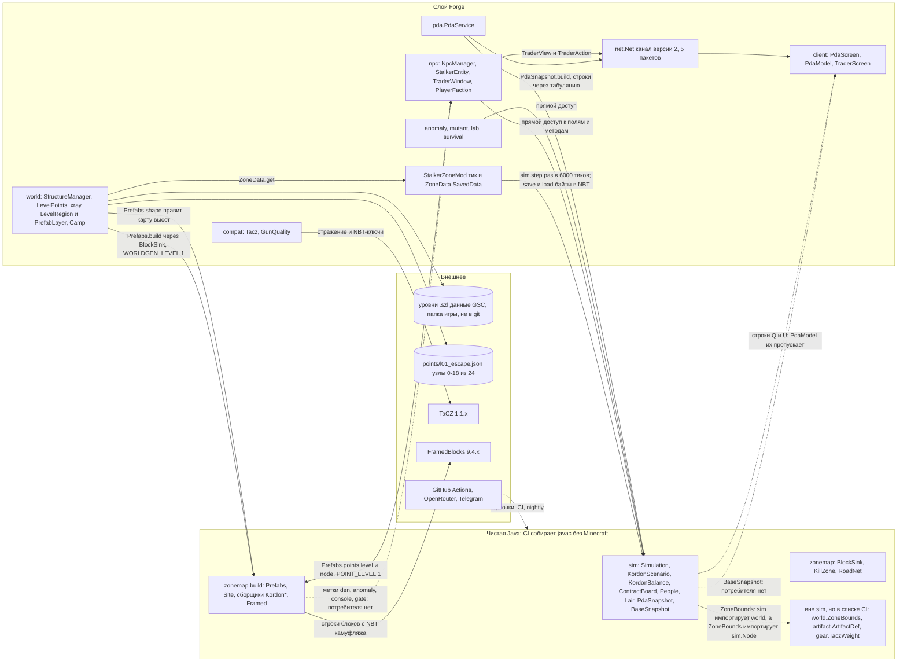

# 02. Аудит игровых систем, модулей, интерфейсов и зависимостей (T2)

## 0. Шапка

| Поле | Значение |
|---|---|
| Роль | Module Engineer (`sonnet-engineer`), временная команда Agent Teams «Аудит»; руководитель — `main` (Fable 5.1) |
| Модель | Claude Sonnet 5.5 (`claude-sonnet-5-5`) — так модель названа в описании сессии |
| Дата | 13.11.2026 |
| Точка отсчёта | main `7aa3e12` (`git rev-parse --short HEAD`), 07.11.2026 13:54 МСК, PR #117; рабочее дерево чистое, кроме папки аудита |
| Режим | Только чтение кода, документов и истории git. Production-код, тесты, сборку и игру не запускал; других файлов не менял |
| Как читать опоры | «проверено по коду» — прочитаны указанные `файл:строка` на `7aa3e12`; «предположение» — вывод из кода без запуска; поведение в игре нигде не проверялось (в облаке нет `.szl`) |
| Что прочитано | `CLAUDE.md`, `docs/claude/00…07`, журналы `10`/`11`, `docs/tasks/README.md` и карточки, `.clinerules`, навык `stalkerzone-dev`, `build.gradle`, `mods.toml`, workflows, `tools/ci`, `tools/conveyor`, `tools/notify`; из кода целиком или большими кусками — `sim/KordonScenario`, `Scenarios`, `NodePopulation`, `ContractBoard` (доска Кордона), `Simulation` (шаг, сохранение, маршруты), `PdaSnapshot`, `BaseSnapshot`, `zonemap/build/Prefabs`, `Site`, `KillZone`, `npc/NpcManager`, `StalkerEntity` (бой), `net/Net`, `client/PdaModel`, `world/StructureManager`, `LevelPoints`, `ZoneWorld`, `xray/PrefabLayer`, `compat/Tacz`, `StalkerZoneMod`, `ZoneData`; остальное — заголовки классов, `grep` и счётчики |
| Масштаб | 212 файлов Java в `src/main` (36 744 строки: `sim` 10 754, `zonemap` 7 716, `world` 5 376, `npc` 4 230, `client` 1 472, `anomaly` 1 119); 80 файлов в `src/test/java` (78 тестов `*Test.java` + помощники `KordonWar.java`, `MapPreview.java`; 6 868 строк) |

### Главные находки (подробности и опоры — в разделах ниже)

1. **Документы отстают от кода на 32–37 коммитов.** `00-start-here.md` и `02-prompts.md` сверены 06.11 16:45 (последняя правка `62c2d6a`, main `c4e3290`); с тех пор слиты PR #81…#117, из них 23 коммита сделал конвейер. Утверждение «военные и бандиты выключены» неверно: в `kordon` есть гарнизоны блокпоста и АТП (раздел 3, строки а1–а4).
2. **Уровни построек в мире заморожены на уровне 1.** Постройки ставятся один раз при генерации (`PrefabLayer.java:20`), места NPC берутся при `Prefabs.POINT_LEVEL = 1` (`Prefabs.java:26`, `NpcManager.java:369`), `StructureManager` для узлов уровня ничего не перерисовывает (`StructureManager.java:34-43`). Следствие: пулемётчик карточки 056 в игре недостижим (место `mg` ставится только на уровне 2+), а «уровни 0–3» сборщиков и уровни `Building` в симуляции в мире не видны.
3. **Заставы туннеля (узлы 22 и 23) населены только в симуляции.** Места сборщика `KordonTunnel` привязаны к узлу 7 без владельца; у узлов 22 и 23 нет ни площадки, ни записи в `points/l01_escape.json` (там узлы 0–18), поэтому `NpcManager` не создаёт там людей (`NpcManager.java:298,360`).
4. **Интерфейсы П-08 и П-09 — пока только данные.** Отряды и население (`Q`, `U`, карточка 051) попадают в снимок КПК, но `PdaModel.parse` их пропускает, вкладок по-прежнему пять (`PdaScreen.java:20`). `BaseSnapshot` (карточка 052) не вызывается ни пакетом, ни командой, ни экраном; «пульт» в штабе — ванильная кафедра с меткой `console`, которую никто не читает (`KordonVillage.java:120,317`). Окно торговца П-07 сделано (#85), но документы пишут «код готов к выдаче».
5. **Связь sim ↔ world держится на прямом доступе к публичным полям `Simulation`** (`sim.nodes` — 56–60 обращений вне пакета `sim`, `sim.factions` — 58–63) и на номерах узлов, продублированных константами в `KordonBalance`, `Prefabs`, `NodePopulation`, `ContractBoard` (раздел 2).
6. **Часть механик существует только в симуляции:** территории логов (061), добыча (062), грызня видов (064), конвои, уровни зданий. Мир (065 не сделана) их не использует: `MutantManager` не вызывает `LairTerritory`.
7. **Контракты «Малого Кордона» частично спящие:** заказ «выбить врага с элеватора» не выдаётся на старте, потому что элеватор уже у одиночек (`ContractBoard.java:287`, `KordonScenario.java:257`). Он оживает, когда узел теряет владельца после выброса (`Simulation.java:1763-1775`) или набега мутантов (`:1192`): по прогону `sonnet-qa` (kordon, 8 сидов по 120 дней) контракт выдан 22 раза.
8. **Тестами покрыт только чистый слой.** Пакеты `npc`, `world` (кроме `ZoneBounds`), `client`, `net`, `anomaly`, `mutant`, `lab`, `compat`, `gear` (кроме `TaczWeight`) проверяются лишь косвенно: `server_smoke.sh` проверяет мир, TPS и сохранение, но игрока в нём нет, NPC и окна не создаются.
9. **Расхождение инструментов:** `tools/simtest.ps1` не содержит `gear/TaczWeight.java`, поэтому `TaczWeightTest` и `MachineGunnerTest` не скомпилируются локальным прогоном; рабочий список — `tools/ci/test_sources.sh`.
10. **Гигиена репозитория:** в git лежат `bin/main` и `bin/test` (≈3 300 файлов), лог-файлы в корне, два побайтово одинаковых файла точек (`kordon_points.json`, `points/l01_escape.json`); `KordonPoints.java` нигде не используется.

## 1. Инвентаризация игровых систем

Условные обозначения состояния: **работает** — есть в игровом цикле и достижимо; **частично** — часть достижима, часть нет; **выключено** — код есть, на Кордоне не действует; **только в симуляции** — считает `sim`, мир или интерфейс не использует. Владелец — по ролям из `00-start-here.md:13-15` и `02-prompts.md`: Программист (всё, кроме облика построек), Строитель (`zonemap/build/*` кроме `Site`, `Prefabs`; `tools/prefab`; `docs/kordon_objects`), Конвейер (карточки с паспортом «Конвейер: да»), Штаб (документы 00/01/02).

### 1.1 Ядро симуляции (`sim`, чистая Java)

| Система | Где в коде | Что делает | Состояние | Тесты | Документ | Владелец |
|---|---|---|---|---|---|---|
| Шаг симуляции и сценарии | `sim/Simulation` (2 966 стр.), `Scenarios`, `ZoneScenario` (345), `KordonScenario` (380), `ZoneGraph`, `Node` | День = 6 000 тиков (`StalkerZoneMod.java:20,92-94`); порядок шага — `Simulation.java:1542-1571`; сценарии `zone`, `kordon` (по умолчанию, `Scenarios.java:12`), `kordon_war` (054) | **работает** для `kordon`; `zone` и `kordon_war` выбираются только системным свойством `stalkerzone.scenario` (`Scenarios.java:19-22`) | `SimDeterminismTest`, `KordonScenarioTest`, `SmallKordonFactionsTest`, около 20 тестов на `ZoneScenario` (грубый подсчёт `grep`) | `01-malyi-kordon.md` (частично устарел), `README.md` | Программист |
| Узлы «Малого Кордона», баланс, темп | `KordonScenario` (24 узла, индексы 0–23), `KordonBalance` (379), `ZONE_OUTPOSTS`, `SMALL_OUTPOSTS`; класса `KordonPace` нет — темп (карточка 034) проверяет `KordonPaceTest`, константы лежат в `KordonBalance` | Топология, владельцы, стартовые логова, районы аномалий, проходы через насыпь | **работает**; номера узлов зашиты в `KordonBalance.java:19-25,38-41,75-77,151-155` | `KordonSmallNodesTest`, `ZoneOutpostsTest`, `KordonBalanceTest`, `KordonPaceTest`, `KordonLairsTest`, `LairMoveTest` | `01-malyi-kordon.md`, `07-plan-to-bridge.md`, карточки 034, 044, 059, 060 | Программист / Конвейер |
| Экономика и торговля (ядро) | `GlobalMarket` (305), `Ledger` (37), `Good`, `Stock`, `Simulation.playerBuy/Sell/quote*` (`:816-950`), `KordonBalance.traderStartCash` (`:187`), `Simulation.audit()` | Рынок Большой земли, касса торговцев, закон сохранения, аудит раз в день (`StalkerZoneMod.java:100-104`) | **работает** | `MarketTest`, `TradeTest`, `TraderCashTest`, `TraderQuoteTest`, `SidorovichTest`, `TradersTest`, `CanonEconomyTest` | `04-interfaces.md` §1, `README.md` | Программист |
| Контракты | `sim/ContractBoard` (771), `Contract` (151); доска Кордона — `ContractBoard.generateKordon` (`:255-370`) | Заказы торговцев, одиночек, военных, бандитов; «Разведка АТП» (058); зачистка Л3 и доставка на О7 (050) | **частично**: заказ «элеватор» спит до потери узла, заказы бандитов и военных достижимы лишь для игрока соответствующей группировки (раздел 5.1) | `KordonContractsTest` (идёт на `kordon_war`), `SmallKordonContractsTest`, `BanditHostilityTest`, `SocietyTest` | карточки 006, 021, 022, 026, 050, 058 | Программист / Конвейер |
| Группировки и политика | `Faction` (`garrisonOnly`, `Faction.java:28`), `Politics` (315), `Doctrine`, `FactionBrain`, `UtilityBrain` (365), `KordonBalance.*Brain` (`:281,330,353`), `Crossings`, `Gate`, `Simulation.resolveWars` (`:2402`) | ИИ фракций (цель, торговля, наступление), единство, встречи, пошлины на проходах | **работает**; в `kordon` военные (узел 2) и бандиты (узел 5) — гарнизоны без ИИ (`Simulation.java:1970`), полная война — только `kordon_war` | `FactionTest`, `BrainTest`, `CrossingsTest`, `GateTest`, `SmallKordonFactionsTest`, `AtpBanditsTest`, `BanditHostilityTest`, `ElevatorOutpostTest` | `stalker-mod-kordon-factions-logic.md`, журнал `10`, карточки 054, 057, 058, 066; `00-start-here.md` устарел | Программист / Конвейер |
| Люди, роли, распорядок | `People` (632), `Person`, `NodePopulation` (96), `BaseRoles` (66; в постановке «WorkRoles» — это `BaseRoles`, тест `WorkRolesTest`), в мире: `npc/WorkScheduleGoal`, `NpcManager`, `StalkerEntity` | Именные сталкеры, ранги, число людей на узле, роли часовой, повар, механик, дежурный, житель, пулемётчик | **частично**: роль MG недостижима, заставы 22 и 23 без людей в мире (раздел 5.1) | `NodePopulationTest`, `WorkRolesTest`, `MachineGunnerTest`, `SmallOutpostsTest`, `LifeTest` | карточки 032, 033, 046, 056 | Программист |
| Тактика боя | `sim/tactics/*` (Accuracy, CoverFinder, Morale, SquadOrders); в мире — `npc/combat/*` (TacticalCombatGoal 356, CombatState, FleeGoal, WorldGrid) | Укрытия, мораль, приказы отряду | **работает** (логика чистая, исполнение в мире без тестов) | `TacticsTest` | `stalker-mod-v116-combat-player.md` | Программист |
| Логистика и отряды | `Logistics` (716), `Convoy`, `Caravan`, `Command` (`sealed interface`: Trade/Attack/Production/Stance — используется только внутри `sim`) | Конвои снабжения, караваны торговцев, курьеры | караваны — **работает** (`npc/CaravanManager`); конвои — **только в симуляции** | `LogisticsTest`, `PdaSquadsTest` | `stalker-mod-logistics.md`, `04-interfaces.md` §2 | Программист |
| Логова и мутанты (ядро) | `Lair`, `LairKind`, `LairTerritory` (061), `Simulation.lairsDaily/raid/overrun` (`:1100-1205`), `KordonBalance.START_LAIRS` | Рост силы, налёты, добыча (062), налёт от перенаселения (063), грызня видов (064) | **частично**: рост и налёты видны через `MutantManager`; территории, добыча, грызня — **только в симуляции** | `LairTest`, `LairL3Test`, `LairMoveTest`, `LairTerritoryTest`, `LairPreyTest`, `LairOverpopulationTest`, `MutantRivalryTest` | карточки 047, 060–064, `lair-territories.svg` | Программист / Конвейер |
| Аномалии, выброс, радиация (ядро) | `Anomaly`, `AnomalyDistrict` (+ поле А6, карточка 048), `Simulation.anomaliesDaily` (`:481`), `emission` (`:1749`), `radiationNodes` | Районы и поля, смещение после выброса, артефакты | **работает** | `AnomalyTest`, `AnomalyPlacementTest`, `AnomalyRadiusTest`, `KordonAnomaliesTest`, `DumpAnomaliesTest`, `EmissionTest` | карточки 013, 029, 043, 048, `README.md` | Программист |
| Лаборатории, пси, Монолит | `Labs` (215), `Lab`, `ScorcherProject`, `Psi` | Исследования, Выжигатель | **выключено на Кордоне**: `Labs` ищет узлы по точным именам («Агропром», «Тёмная долина», «Янтарь», «Радар», «ЧАЭС», `Labs.java:21`), на Кордоне их нет; `Psi.java:34` для Кордона возвращает 0 (карточка 024) | `PsiKordonTest`, `MonolithTest` (сценарий `zone`) | `README.md` («Лаборатории») | Программист |
| Игрок (ядро) | `PlayerStart` (81), `PlayerCareer` (99) | Точка старта и возрождения, набор новичка, карьера | **работает** | `PlayerStartTest` | `01-malyi-kordon.md` («Роль игрока») | Программист |

### 1.2 Игровой слой (Forge)

| Система | Где в коде | Что делает | Состояние | Тесты | Документ | Владелец |
|---|---|---|---|---|---|---|
| Окно торговца | `npc/TraderWindow` (333), `TradeService` (292), `client/TraderScreen` (345), `Net.TraderView/TraderAction` (`Net.java:134,208`), открытие — `StalkerEntity.java:597` | ПКМ по торговцу: товары, рюкзак с ценой выкупа, итог сделки до подтверждения, заказы, ремонт | **работает** (PR #85, `62c2d6a`) | ядро — `TraderQuoteTest`; окно и пакеты **без тестов** | `04-interfaces.md` §1 (пишет «код готов к выдаче» — устарело) | Программист |
| Касса | `Node.market.money`, `cashReserve`, `mainlandRevenue` (`KordonScenario.java:~290-300`), `TradeService` | Деньги торговца и игрока через `Ledger` | **работает** | `TraderCashTest` | карточка 025 | Программист |
| КПК | `pda/PdaService` (227), `PdaItem`, `ZoneLifeService` (213), `sim/PdaSnapshot` (244), `Net.PdaSnapshot/PdaAction`, `client/PdaScreen` (398), `PdaModel` (101), `PdaMapCache`, `ClientPda` | Карта-граф узлов, задания, новости, отношения, лаборатории | **частично**: пять вкладок как в карточке 015; карта П-08 (рельеф, отряды, карточки узлов) не сделана; класса «PdaSquads» нет — отряды собирает `PdaSnapshot.squads` (`:87-100`) | `PdaKordonTest`, `PdaSquadsTest` (только формат строк) | `04-interfaces.md` §2, `docs/ui/p08-pda-map.png` | Программист |
| Пульт базы | `sim/BaseSnapshot` (65), `KordonVillage.CONSOLE` (кафедра, место `console`) | Данные обзора, жителей, построек, склада, журнала | **только данные**: нет пакета, экрана, команды; `console` без потребителя | `BaseSnapshotTest`, `VillageTest` (кафедра) | `04-interfaces.md` §3–4, карточка 052 | Программист (экран) / Строитель (блок) |
| Игрок (мир) | `npc/PlayerFaction` (318), `DeathBackpack*` (сущность с окном, #74), `item/StartKit`, `survival/PlayerNeeds`, `Radiation`, `world/ZoneWorld` (вход, граница) | Вступление в группировку, смерть и возрождение, рюкзак смерти на 20 минут, сон и радиация | **работает** | `PlayerStartTest` (ядро); рюкзак и нужды — без тестов | `01-malyi-kordon.md`, `docs/checklist/p10-playtest-fixes.md` | Программист |
| Снаряжение и оружие | `gear/*` (`Suit`, `Weight`, `Carry`, `FactionGear`, `TaczWeight`), `compat/Tacz` (отражение), `GunQuality`, `GunAttackGoal`, `CompatConfig`, `GunPackInstaller`, ресурсы `szguns_pack` (142 файла в `files.txt`) | Вес, ячейки, костюмы, оружие TaCZ у NPC, кустарное и заводское | **работает** при TaCZ; без TaCZ NPC дерутся врукопашную (`Tacz.java:91-103`) | `TaczWeightTest`, `ArmsTest` (ядро) | `README.md` (v1.12–1.13), `stalker-mod-v116-combat-player.md` | Программист |
| Аномалии, артефакты, выброс (мир) | `anomaly/AnomalyManager` (462), `Artifacts`, `EmissionEvent` (342), `PsiField`, `artifact/*` (`ArtifactDef` 178, `Belt` 155), `world/RadioactiveSpots` | Частицы, урон, скрытые артефакты и детекторы, выброс со стадиями, укрытия | **работает**; `PsiField` на Кордоне не действует (`PsiField.java:60`) | `ArtifactTest` (каталог); остальное без тестов | карточки 013, 029, 030 | Программист |
| Мутанты (мир) | `mutant/MutantManager` (206), `MutantEntity` (305), `MutantType`, `MutantRegistry` | Мутанты у логова по силе логова | **частично**: бродят у логова, территорий и грызни нет (065 не сделана) | `MutantTest` (ядро) | карточки 007, 014, 065 | Программист |
| Лаборатории и «зоопарк» полной Зоны | `lab/LabManager` (288), `npc/Hermits`, `ZombieManager`, `world/LandmarkManager`, `MeetingManager` | Лаборатории, отшельники («Кордон Лесника», `Hermits.java:34`), зомби, ориентиры, встречи лидеров | **выключено на Кордоне** (привязка к узлам по именам, которых там нет); `MeetingManager` в «Малом Кордоне» не проверялся (предположение) | нет | `README.md` | Программист |
| Генерация мира и площадки | `world/xray/*` (LevelRegion, XrayPlacer, PrefabLayer, XrayTerrain, LinkRoads), `ZoneBiomeSource`, `StructureManager`, `LevelPoints`, `zonemap/build/Site` (199), `Prefabs` (222) | Рельеф из `.szl`, плато, расчистка вокселей, постройки, места NPC, декор | **работает**: 9 площадок (`Prefabs.java:64-84`) | `SiteTest`, `PrefabsTest`, `ChunkLoadPlaceTest`, `FramedTest`, `FenceTrapdoorTest`; `server_smoke.sh` на синтетическом `.szl` | `01-malyi-kordon.md`, `00-start-here.md` («Как добавить сборщик»), `README.md:99-111` (устарел) | Программист (механизм) |
| Сборщики построек | `zonemap/build/Kordon*`: Village (542), Bunker (344), SouthPost (437), Wagon (155) + RoadBridge (127), Dump (246), Tunnel (467), ATP (517), Elevator (318); не подключены: Farm (351), FarPost (379), BridgeTunnel (273); общие: `Buildings` (992), `Structures` (564), `Vehicles`, `Framed`, `B` | Облик построек по обмерам оригинала, уровни 0–3, места NPC, укрытия | **работает** для 8 площадок; 3 сборщика не подключены; уровни 0–3 в мире не применяются (раздел 5.1) | `VillageTest`, `BunkerTest`, `SouthPostTest`, `AtpTest`, `ElevatorTest`, `TunnelTest`, `KordonO7Test`, `KordonDumpTest`, `WagonSiteTest`, `LairDenSiteTest` | `docs/kordon_objects/*`, журнал `11` | Строитель |
| Лагеря и декор (общий) | `world/Camp` (593), `Dressing`, `Landmarks` (694), `WorldDecorator` (545), `Roads` + `zonemap/RoadNet`, `Perimeter`, `WallBuilder` | Общие лагеря для узлов вне уровня, костёр, флаг и ящики по JSON, лес и хлам, граница Зоны | **частично**: лагеря работают для сценария `zone`; на Кордоне действуют `Camp.placeLevelDecor`, `WorldDecorator`, граница | `RoadNetTest`, `BoundsTest` | `README.md` | Программист |
| Команды `/zone` | `ZoneCommands` (673), `sim/Report` (246) | Около 55 подкоманд: отчёты, торговля, контракты, отладка (`step`, `reset`, `tp`, `rebuild` требуют `hasPermission(2)`) | **работает** | вручную `tools/smoketest.ps1` по `tools/smoke_checks.txt`; в CI не запускаются | `README.md:475` | Программист |

### 1.3 Конвейер, бот, инструменты

| Система | Где в коде | Что делает | Состояние | Тесты | Документ | Владелец |
|---|---|---|---|---|---|---|
| Конвейер v2 | `.github/workflows/conveyor.yml` (82), `tools/conveyor/*` (card, check, conveyor.sh, mark_done, metrics, next_card), `docs/tasks/*`, `docs/tasks/tests/*` (23 файла) | Карточка = красный тест + узкое задание; Cline + `deepseek/deepseek-v4.1-flash`; ≤ 15 мин и ≤ $0,30; PR сливает человек; статус ставит `mark_done.py` после слияния | **работает** (с 06.11; по карточкам 042–066 слито 23 PR конвейера) | `ConveyorTest`, `ChecklistTest` (проверяют файлы, не поведение) | `06-conveyor-v2.md`, `docs/tasks/README.md` | Программист / Штаб |
| Сервер в CI | `build.yml` (job `server`), `tools/ci/server_smoke.sh`, `rcon.py`, `tools/xray/fake_szl.py` | Синтетический уровень, мир, загрузка чанков площадок, TPS ≥ 15, сохранение | **работает** (игрока и NPC нет) | сам является проверкой | `00-start-here.md` (проблема 3) | Программист |
| Бот и сводки | `tools/notify/*` (tg, balance, daily_report, bot_commands), workflows `notify`, `daily-report`, `bot-commands` (cron каждые 30 минут) | Telegram, баланс OpenRouter, команды `/баг /идея /статус /запуск` | **работает** (сбой отправки не роняет CI, `tg.py:20-26`) | нет | `00-start-here.md` | Программист |
| Ревью и `@claude` | `ai-review.yml`, `tools/review/ai_review.py`, `claude.yml` | Дешёвое ревью PR; Claude Code по комментарию `@claude` | **работает**; в v2 ревью — подсказка | нет | `06-conveyor-v2.md` п. 5 | Программист |
| Инструменты уровней и превью | `tools/xray` (Python + C), `tools/prefab` (Java + Python), `tools/props`, `tools/gunpack`, `tools/gen_*.py` | Перенос уровней GSC в `.szl`, превью построек, генерация текстур и моделей | **вручную** на ПК владельца, без тестов и без `requirements.txt` | нет | `tools/xray/README.md`, навык | Программист / Строитель (`tools/prefab`) |

## 2. Карта модулей и интерфейсы между ними

### 2.1 Диаграмма

Сплошные стрелки — связь, которую я нашёл в коде; пунктир — связь, которой нет, хотя документы её обещают, или связь через неявное соглашение.

### 2.2 Реальные контракты между модулями

| № | Граница | Контракт, как он есть в коде | Тип связи | Где хрупко |
|---|---|---|---|---|
| К1 | `sim` → игровой слой, чтение | Прямой доступ к публичным полям `Simulation`: `sim.nodes` (56–60 обращений вне `sim`, счёт `grep` и `sonnet-qa` различается), `sim.factions` (58–63), `sim.people` (11), `sim.contracts` (5), `sim.lairs` (3), `sim.anomalies` (5), `sim.caravans` (5), `sim.labs` (9); `ZoneData.get(server)` — около 70 вызовов в 24–25 файлах (27 из них в `ZoneCommands`) | неявный, без фасада | Любое переименование поля ломает мир; чистый `javac` игровой слой не собирает, поэтому ошибку видит только полная сборка |
| К2 | Игровой слой → `sim`, запись | Методы: `playerBuy/Sell/BuyAll/SellAll/BuyPacks/SellPacks/quoteBuy/quoteSell` (`Simulation.java:816-950`), `contracts.take/abandon/claim`, `mutantKilled`, `npcKilled`, `playerBribe`, `playerConfiscated`, `takePendingArtifacts`, `triggerEmission`, `step`. Для торговли контракт явный (`Deal`); остальное — прямые методы и поля | смешанный | `Command` (`sealed interface`, `sim/Command.java`) наружу не выходит: игрок и мир команд симуляции не отдают |
| К3 | Время | `StalkerZoneMod.onServerTick`: 1 день = 6 000 тиков → `sim.step()` → `ZoneLifeService.daily` → при `lastEmissionDay == day` запуск `EmissionEvent` → `audit()` (`StalkerZoneMod.java:92-104`). Команда `/zone step` делает только `sim.step()` и `life.daily` (`ZoneCommands.java:257-267`): выброс в мире и дневной сервис не запускаются | явный, но дублирован | Два пути «продвинуть день» дают разное состояние мира |
| К4 | `sim` ↔ сохранение | `Simulation.save/load` (`Simulation.java:2605-2966`), версия **22** (`:2609`, `:2771`). Для Кордона версия < 22 даёт «новый мир с тем же сидом» (`:2778-2786`): набор и порядок узлов менять без сброса мира нельзя. Мирные данные лежат в `ZoneData` (`simBytes`, `built`, `campY`, `rendered`, `hidden`, `life`) без собственного номера версии | явный номер + неявный порядок узлов | Карточки 050 и 058 подписаны в коде «v23», «v24» (`ContractBoard.java:296,362`, `Contract.java:17`), хотя версия записи осталась 22: при чтении кода легко принять комментарий за формат |
| К5 | `sim` ↔ мир по номерам узлов | Номер узла дублируется: `KordonScenario` (индексы), `Prefabs.NODE_*` (`Prefabs.java:44`) и литерал `20` для свалки (`:75`), `NodePopulation.java:37` (`n.id == 4`), `ContractBoard.java:364` (`nodes.get(5)`), `KordonBalance` (списки узлов), JSON `nodes[].id` | неявный | Единственная проверка — `SiteTest` («центр узла внутри площадки»); она не знает о заставах 22 и 23 (раздел 5.1) |
| К6 | Мир ↔ `zonemap.build` | Явный: `Prefabs.points(level, Ground, lvl, node)` → `Point(kind,x,y,z)`, `Prefabs.build(level, Ground, lvl)` → `Map<Long,String>`, `Prefabs.shape(level, Site.Grid)`, `Prefabs.killZones`, `Prefabs.cleared/shaped/plateauAt`; сборщик получает `BlockSink` (`set`, `ground`, `mark`) | явный интерфейс, строковые виды меток | Виды меток `kind` — свободные строки; см. К7 |
| К7 | Метки рабочих мест | Производятся (счёт `mark("…"` в `zonemap/`): `rest` 24, `guard` 20, `bed` 16, `work` 15, `shelter` 14, `cook` 9, `patrol` 7, `gate` 6, `duty` 3, `trader` 1, `mg` 1, `kill_line` 1, `den` 1, `console` 1, `anomaly` 1. Потребляются: `guard/patrol/cook/work/duty/bed/rest` — `NpcManager.java:390-409`, `WorkScheduleGoal.java:65-151`; `shelter` — `LevelPoints.pointsOf` (`:113`); `trader` — `LevelPoints.pointOf` (`:105`); `mg` — `NpcManager.java:381`; `kill_line` — `Prefabs.killZones` (`:178`). **Без потребителя:** `den`, `anomaly`, `console`, `gate` (регион шлагбаума читается из JSON, `BridgePost.java:57`) | неявный (строки) | В `00-start-here.md:33` перечислены 8 видов; `mg`, `kill_line`, `den`, `console`, `anomaly`, `trader`, `shelter` и соглашение «`kill_line` — по 4 точки на прямоугольник» (`Prefabs.java:174-178`) нигде, кроме Javadoc, не описаны |
| К8 | Уровень постройки | Две независимые константы: `PrefabLayer.WORLDGEN_LEVEL = 1` (блоки) и `Prefabs.POINT_LEVEL = 1` (места NPC). Уровень `Building` из симуляции в `Prefabs` не передаётся нигде | неявный, разорван | Комментарий «дальше их меняет развитие баз» (`PrefabLayer.java:19`) не соответствует коду |
| К9 | Два источника точек | Места сборщиков (`Prefabs`) и файл `points/l01_escape.json` (`guards`, `beds`, `campfire`, `shelter`, `flag`, `gate`, `roads`). `LevelPoints.pointOf` берёт сначала сборщик, потом JSON; `NpcManager.spawnAtLevelPoint` для узла без площадки идёт по JSON (`:298-340`); декор `Camp.placeLevelDecor` читает только JSON и знает про сборщик лишь флаг `beds` (`StructureManager.java:75-76`, `Camp.java:518`) | неявный | Дубли костров и ящиков на узлах 4, 5, 7 — открытый запрос Строителя (раздел 2.3) |
| К10 | Клиент ↔ сервер | `Net` (`Net.java:20`): канал `stalkerzone:main`, версия `"2"`; пакеты 0 `PdaSnapshot` (S→C, строка до 2^18 байт), 1 `PdaAction`, 2 `EmissionPhase`, 3 `TraderView`, 4 `TraderAction`. Торговец типизирован (`record Row/ContractRow/Quote`); КПК — построчный текст | явный для торговца, неявный (текстовый формат) для КПК | Формат КПК описан только в Javadoc `PdaSnapshot.java:10-18` и карточке 051. Сервер шлёт строки `D P B N G F H T M E Q U C L R A Z X S` и (из `PdaService.java:59-62`) `W K Y`; `PdaModel.parse` разбирает `D P B N G F H T M E C L R A Z W K S X Y` и молча пропускает `Q` и `U` (`PdaModel.java:50-76`). `PdaModel` лежит в клиентском пакете, поэтому круговой тест «собрать → разобрать» невозможен без Minecraft |
| К11 | `BaseSnapshot` | Формат строк `O R B S J` (`BaseSnapshot.java:10-20`) | только производитель | Нет пакета, экрана, команды; единственный потребитель — `BaseSnapshotTest` |
| К12 | Тесты ↔ чистый слой | `tools/ci/test_sources.sh` вручную перечисляет чистые файлы: `sim/**`, `zonemap/**` и три файла (`world/ZoneBounds`, `artifact/ArtifactDef`, `gear/TaczWeight`). Копии списка: `tools/simtest.ps1` (без `TaczWeight`), `SKILL.md` (старый список). Граница «в `sim` и `zonemap` нет `net.minecraft`» держится компиляцией; `grep net.minecraft` по обоим пакетам сейчас пуст (проверено) | неявный, три копии | Новый чистый класс вне двух пакетов без правки списка ломает CI или локальный прогон |
| К13 | Выбор сценария | `Scenarios.current()` читает системное свойство (`Scenarios.java:19-22`); `ZoneWorld.init()` (`ZoneWorld.java:28-35`) и `LevelRegions.all()` (`LevelRegions.java:23`) используют его, а `ZoneData` строит симуляцию тем же свойством только при создании мира, дальше берёт сохранённый `sim.scenario` | неявный | Два источника правды о сценарии; выбрать `kordon_war` из игры нельзя |
| К14 | Сборка ↔ TaCZ | Отражение: `IGunOperator.draw/shoot/aim/initialData` (`Tacz.java:93-98`), события `EntityHurtByGunEvent$Pre`, `GunShootEvent`, `GunReloadEvent` (`GunQuality.java:123-129`); NBT-ключи оружия и патронов (`Tacz.java:80-83`, `TaczWeight`) | неявный (имена методов и ключей) | При смене API включается флаг `reflectFailed`, NPC дерутся врукопашную, в лог идёт предупреждение; смена NBT-ключей не даёт исключения и проходит тихо (предположение) |
| К15 | Сборка ↔ FramedBlocks | Строки блоков `framedblocks:framed_*` с NBT камуфляжа (`Framed.java:9-13`); `Framed.loaded` ставит мод при старте (`StalkerZoneMod.java:44`); без мода — ванильные ступени и плиты | неявный (идентификаторы и формат NBT версии 9.4) | См. раздел 4 |
| К16 | Конвейер ↔ код | Паспорт карточки (`**Конвейер:** да`, `**Тест:**`, `**Файлы:**`) → `tools/conveyor/card.py` → `docs/tasks/tests/*Test.java` копируется в `src/test/java` → `check.sh` → PR; статус «готово (конвейер)» ставит `mark_done.py` после слияния (#116) | явный, проверяется `ConveyorTest` | Исполнителю разрешены только файлы из паспорта; карточки 055 и 056 правят код мира (`StalkerEntity`, `NpcManager`), проверяемый лишь чек-листом (журнал `10`, запись 06.11 23:59) |

### 2.3 Граница ролей Строитель / Программист / Конвейер

Заявленное правило (`00-start-here.md:13-15`, `02-prompts.md`): Строитель меняет `zonemap/build/*` кроме `Site.java` и `Prefabs.java`; исключение — строка регистрации своего сборщика в `Prefabs.SITES` и места деревни. Что видно в истории (проверено `git show --stat`):

- **Строитель правит общие файлы Программиста в каждой постройке.** PR #70, #98, #101, #106 меняют `Prefabs.java` (допустимо по правилу). Кроме того PR #98, #99, #101, #103, #106 меняют общие тесты `SiteTest`, `PrefabsTest`, `WorkRolesTest`: потолок числа часовых в `WorkRolesTest.java:109` поднимали 19 → 21 → 23 вручную при каждой заставе. Это не запрещено, но каждый новый сборщик заставляет трогать чужой тест (в навыке это названо «частые конфликты»).
- **Конвейер правит механизм площадок.** Площадку `dump` в `Prefabs.SITES` зарегистрировала карточка 045 (#92, бот) с литералом `20` вместо константы (`Prefabs.java:75`); карточка 053 добавила площадку `lair` и `Prefabs.lairL3` (`:85-91`).
- **Открытые запросы Строителя к Программисту без выполнения:** декор узлов 4, 5, 7 ставит второй костёр и случайные ящики на точку костра сборщика (`11-log-builder.md`, записи П-21, П-22, П-23); `Camp.placeLevelDecor` учитывает только флаг `beds` (`Camp.java:518`, `StructureManager.java:75-76`). Запрос про принадлежность узла 5 бандитам закрыт карточкой 057, про элеватор — карточкой 066.
- **Конвейер выходит за заявленные рамки.** `06-conveyor-v2.md` п. 2 запрещает карточки «интерфейсы, всё, где готово нельзя проверить тестом», но карточка 055 правит `StalkerEntity` (бой в мире), а 056 — `NpcManager` (спавн); в журнале сказано, что в мире они проверяются «по чек-листам» (`10-log-programmer.md`, 06.11 23:59). Пример последствий — недостижимый `mg` (раздел 5.1).
- **Журналы ведутся неравномерно.** `10-log-programmer.md` не содержит записей после 07.11 00:17 (PR #106, #111–#117 без записей); в `11-log-builder.md` порядок записей нарушен (запись П-22 от 07.11 лежит ниже записей 06.11).

## 3. Соответствие документов коду

Дата сверки документов — 06.11.2026 16:45 (`00-start-here.md`, `02-prompts.md`); код — main `7aa3e12` (07.11.2026). Вердикты: **совпадает**, **устарело** (было верно, обогнано кодом), **противоречит** (документ или код расходится с другим документом или собой), **не сделано** (в документе обещано, в коде нет).

### (а) Группировки: «военные и бандиты выключены»

| № | Утверждение документа | Документ и дата | Что в коде | Вердикт |
|---|---|---|---|---|
| а1 | «Группировка одна — одиночки; военные и бандиты на это время выключены» | `00-start-here.md:39` (06.11), `01-malyi-kordon.md:7`, `02-prompts.md:79` (промпт «Программист») | `KordonScenario.java:66` (в сценарии 40 одиночек, 24 военных, 28 бандитов), `:237,241` (`garrisonOnly = !war` у бандитов и военных), `:258,261` (АТП — бандиты, южный блокпост — военные). Тесты `SmallKordonFactionsTest`, `AtpBanditsTest`. PR #111 (054), #113 (057), #115 (058); решения пользователя 06.11 23:38–23:50 (`10-log-programmer.md`) | **устарело** |
| а2 | Военные — только гарнизон южного блокпоста (узел 2), неподвижный, без отрядов и захвата; мост ничей | `10-log-programmer.md` (06.11 23:59), карточка 054 | `KordonScenario.java:241,261,263` (мост у военных только `if (war)`), `Simulation.java:1970` (`think` возвращается для `garrisonOnly`), `NodePopulation.java:45` | совпадает |
| а3 | Бандиты — только АТП (узел 5): гарнизон по уровню базы, без отрядов; дальний блокпост ничей | карточка 057 | `KordonScenario.java:237,258-260`, `NodePopulation.java:25-31,45` (`min(12, 4 + 2 × уровень)`); в мире бандиты враждебны игроку через `PlayerFaction.npcHostile` (`f.raider`, `PlayerFaction.java:65`) | совпадает |
| а4 | Полная война трёх группировок — отдельный сценарий `kordon_war` | карточка 054, журнал `10` | `Scenarios.java:8,30`, `KordonScenario.java:81-84`; выбирается только `-Dstalkerzone.scenario` (`Scenarios.java:19-22`) | совпадает, но в `00`/`01` не описан |
| а5 | Маршруты одиночек обходят АТП; контракт «Разведка АТП» | карточка 058 | `Simulation.java:1368-1390` (`route` + `pathAvoiding`), `ContractBoard.java:362-368`, `Contract.java:17` | совпадает |
| а6 | «Остальной Кордон — фон без жизни» | `01-malyi-kordon.md:7` | Свиноферма (узел 10) принадлежит одиночкам (`KordonScenario.java:255`, `farmCap = 45` на `:133`), у узла есть точки в JSON (`guards`, `campfire`), значит NPC появятся при подходе игрока (предположение: в игре не проверялось). Элеватор — застава одиночек (`:257`) | **противоречит** |
| а7 | В бою военные враждебны игроку и одиночкам, как задаёт матрица вражды | карточки 012, 054 | `StalkerEntity.java:342,353` (055): военный NPC враждебен только внутри `kill_line` — во всех сценариях, без учёта репутации и `BridgePost`; в `kordon_war` (мост у военных) логика карточки 012 («Стоять! Назад!») теряет эффект (предположение: в игре не проверялось). Уточнение `sonnet-qa`: в сценарии без уровня (`zone`) `killZones()` пуст (`levelForScenario` даёт `null`), поэтому ветка `isMilitary()` (`:341-342`, `:353`) делает военных невраждебными игроку и одиночкам вовсе | **противоречит** (код карточки 055 против 012) |
| а8 | «Новый отдельный сценарий не делать»: номера узлов зашиты в `KordonBalance`, `ContractBoard`, мозги группировок | `01-malyi-kordon.md:50`, `02-prompts.md:81` | Добавлен отдельный сценарий `kordon_war` (`Scenarios.java:8,30`, `KordonScenario.create(seed, war)`); решение «полную войну не выкидываю» записано только в `10-log-programmer.md:25` (замечание `sonnet-qa`) | **противоречит** (правило не обновлено) |

### (б) Площадки: «отключены АТП, элеватор, свиноферма, дальний блокпост, мост/туннель»

| № | Утверждение | Документ и дата | Что в коде | Вердикт |
|---|---|---|---|---|
| б1 | «Отключены сборщики АТП, элеватора, свинофермы, дальнего блокпоста, моста/туннеля (классы оставить)» | `00-start-here.md:53,74` (05.11), `01-malyi-kordon.md:41` (01.11), `README.md:106` (05.11) | `Prefabs.java:64-86`: подключены `atp` (узел 5, #101/#103), `elevator` (4, #106), `tunnel` (7, #98), а также `wagon` (19), `dump` (20), `lair` (21). Не подключены `KordonFarm`, `KordonFarPost`, `KordonBridgeTunnel` (мост 8, свиноферма 10, дальний блокпост 11) | **устарело** (наполовину) |
| б2 | Площадки village, bunker, south_post; «новые» wagon, dump, lair | `01-malyi-kordon.md:37-42` | Есть все; плато wagon `104..130 × −88..−60`, dump `−54..−22 × −134..−108` совпадают (`Prefabs.java:70,75`); lair — без плато (`:85`) | совпадает |
| б3 | Высота плато — только AUTO | `01-malyi-kordon.md:26`, `00-start-here.md:56` | `Site.AUTO` везде (`Prefabs.java:67-82`) | совпадает |
| б4 | Ж/д мост и насыпь (П-19) — «осталось» | `07-plan-to-bridge.md` | Узла 8 нет среди площадок (`SiteTest.java:106` проверяет «у узла без площадки (мост, 8) мест нет») | совпадает (**не сделано**) |
| б5 | `Prefabs.villagePoints` — места деревни | `00-start-here.md:11,33,97`, `02-prompts.md:32` | Поля в коде нет (`grep villagePoints src` пусто); места деревни даёт сборщик `KordonVillage` | **устарело** |
| б6 | Файл `claude/03-draft-site.md` описывает `Site` | `01-malyi-kordon.md:34`, `02-prompts.md:119` | Файла в репозитории нет; в карте документов он «архив» (`00-start-here.md:118`) | **устарело** (ссылка в никуда) |
| б7 | Корневой `README.md`: раздел «Площадки Кордона» | `README.md:99-111` (05.11) | Не отражает площадки wagon, dump, tunnel, atp, elevator, lair; в нём нет разделов про П-07, 044–066, `kordon_war` | **устарело** |

### (в) `04-interfaces.md`: П-07, П-08, П-09

| № | Утверждение | Документ и дата | Что в коде | Вердикт |
|---|---|---|---|---|
| в1 | П-07 «код готов к выдаче (после П-12, П-13)» | `02-prompts.md:26`, `00-start-here.md:48` (06.11) | `62c2d6a` (#85, 06.11 17:23): `TraderWindow`, `TraderScreen`, `Net.TraderView/TraderAction` (`Net.java:20,134,208`, версия канала 2), открытие `StalkerEntity.java:597`, `Simulation.quoteBuy/quoteSell` (`:930-937`), `TraderQuoteTest` | **устарело** (сделано) |
| в2 | «В КПК (`PdaModel`, `PdaSnapshot`) отряды не передаются» | `04-interfaces.md:7` («Что есть сейчас», main `027de02`) | `PdaSnapshot.java:87-120`: строки `Q` и `U` есть с карточки 051 (#89). Но `PdaModel.parse` их не знает (`PdaModel.java:50-76`, `default → { }`) | половина **устарела**; «на экране отрядов нет» — совпадает |
| в3 | П-08: карта КПК с рельефом, отметками, отрядами и карточкой узла | `04-interfaces.md` §2 | `PdaScreen.java:20`: пять вкладок «Карта, Задания, Новости, Отношения, Лаборатории»; карта — граф узлов и подложка `PdaMapCache` по разведанным клеткам. Класса «PdaSquads» нет, данные отрядов — `PdaSnapshot.squads` (`:87`), тест `PdaSquadsTest` | **не сделано** (данные готовы) |
| в4 | П-09: «журнал старшего» в штабе, ПКМ открывает окно базы | `04-interfaces.md` §3 | `KordonVillage.java:120` (кафедра `minecraft:lectern`), `:317` (метка `console`; потребителя нет, `grep "\"console\""` даёт только этот `mark`), `BaseSnapshot` (#96) без вызова, пакета `Net` под него нет | **не сделано** (данные и блок готовы) |
| в5 | П-09 §4: вкладка «Группировки» — карточки с эмблемой, базами | `04-interfaces.md` §4 | Вкладка «Отношения» показывает строки `F`/`H` (`PdaModel.java:63-68`) | **не сделано** |
| в6 | Окно торговца: сервер авторитетный, окно только просит | `04-interfaces.md` §1 | По описанию `62c2d6a` и структуре `TraderWindow.handle/view` (`TraderWindow.java:134-176`); построчно проверку «торговец жив и ближе 8 блоков» не перечитывал | совпадает (предположение по описанию PR) |
| в7 | Торговля — «`/zone buy` и ПКМ товаром в руке, список в чат» | `04-interfaces.md:7` | Эти пути остались (`ZoneCommands.java:292-342`), к ним добавлены окно и Shift+ПКМ по торговцу (`StalkerEntity.java:~588-597`) — три входа с независимой проверкой дистанции (сообщение T1 `opus-lead-dev`) | совпадает, но входов три |

### (г) Очередь задач и таблица карточек против git

| № | Утверждение | Документ и дата | Что в git/коде | Вердикт |
|---|---|---|---|---|
| г1 | П-12 и П-13 «готов к выдаче» | `02-prompts.md:23,25` | #79 `c1dc64d`, #80 `c4e3290` слиты 06.11 | **устарело** |
| г2 | Таблица задач заканчивается на П-14 | `02-prompts.md:8-28` | П-16 (#82, кровли), О7 (#83), О12/«П-18» (#86), П-17 (#87), П-17б (#100), П-17в (#105), П-23 (#98), П-20 (#99), П-21 (#101, #103), П-22 (#106) — только в `07-plan-to-bridge.md`, журналах и git. П-19 (ж/д мост) не сделана | **устарело** |
| г3 | Статусы карточек 042–066 «готово (конвейер)» | `docs/tasks/README.md` | Все 23 карточки конвейера имеют слитый PR: #81, #84, #88–#97, #102, #104, #107–#115. Карточки 049 и 065 — «не для конвейера»: 049 подтверждена (`LevelPoints.pointsOf` берёт `shelter` площадок), 065 не сделана | совпадает |
| г4 | Статус «готово» у карточки 061/064 | `docs/tasks/README.md` | Код (`LairTerritory`, `Simulation.mutantKilledByMutant`, `Simulation.java:994`) нигде не вызывается из мира; `MutantManager.java:131,161` держит мутантов радиусом 30 и 40 вокруг логова (T1 `opus-lead-dev`) | совпадает по критерию карточки («тест зелёный»), **не отражает** результат в игре |
| г5 | Цель «Зона 1.0» за 8 недель: «Кордон → Свалка → Тёмная долина…», «Порядок для одного исполнителя 001 → … → 016» | `docs/tasks/README.md:3,131` | Сужено до «Малого Кордона» решением 01.11 (`00-start-here.md:37`); конвейер v2 — одна линия | **противоречит** (внутри самого файла шапка и блок v2) |
| г6 | Переменные конвейера `CONVEYOR_PAUSED`, `AUTO_MERGE`, `MIN_BALANCE`, `CLAUDE_DAILY_LIMIT`, `CLAUDE_RESET_AT` | `00-start-here.md:103`, `:63-64` | Workflows читают `AGENT_MODEL`, `CARD_BUDGET`, `CARD_MINUTES`, `CONVEYOR_PAUSED`, `MIN_BALANCE`, `REVIEW_MODEL`; `AUTO_MERGE`, `CLAUDE_DAILY_LIMIT`, `CLAUDE_RESET_AT` в `.github` и `tools` не встречаются | **устарело** |
| г7 | «На 06.11 16:45 main — `c4e3290`» | `00-start-here.md:96,62` | HEAD `7aa3e12`, +37 коммитов (23 бота, 14 человека/чатов); последняя правка `00-start-here.md` — `62c2d6a` (+32 коммита) | **устарело** |
| г8 | «АТП — без жителей (брошенная база)», решение 06.11 17:35; в плане: «057 АТП — без жителей» | `07-plan-to-bridge.md:6,91` | Решение 06.11 23:50 заменило его на «базу бандитов» (`10-log-programmer.md`); в `07` оно не отражено, в `docs/tasks/README.md` карточка 057 — «Бандиты только на АТП» | **противоречит** (два документа) |
| г9 | `.clinerules`: «`Simulation.java` ~2100 строк»; «тесты на Windows: `tools/simtest.ps1` — то же, что делает CI» | `.clinerules` | `Simulation.java` — 2 966 строк; `simtest.ps1` без `gear/TaczWeight.java`, CI берёт список из `tools/ci/test_sources.sh` | **устарело** |
| г10 | Журнал Программиста — актуален | `00-start-here.md:104` («актуально») | Последняя запись 07.11 00:17; после неё PR #106, #111–#117 без записи | **устарело** |

### (д) `01-malyi-kordon.md`: узлы 19–21 и поздние узлы против `KordonScenario`

| № | Утверждение | Документ | Что в коде | Вердикт |
|---|---|---|---|---|
| д1 | Узел 19 «Лагерь у вагончика» (OUTPOST, одиночки) ≈ (12, −7), дороги к деревне и на север | `01-malyi-kordon.md:51` | `KordonScenario.java:154-156` `OUTPOST`, `(12, −7)`, `housing 8`; владелец одиночки (`:266`); дороги `VILLAGE–WAGON`, `HILL–WAGON` (`:195,203`) | совпадает |
| д2 | Узел 20 «Свалка техники» — аномальная зона, «на старте ничья, одиночки берут как ресурсную точку» ≈ (−4, −12) | `01-malyi-kordon.md:52` | `(-4, -12)`, тип `ANOMALY` (`:158`), но `dump.owner = LONERS` (`:267`): застава О12 на узле с начала (решение 06.11 18:05, карточка 059) | **устарело** |
| д3 | Узел 21 «Лес у свалки техники» ≈ (−7, −10), логово Л3 ≈ (−72, −98), цели набегов: О12/А6, потом О7, деревня | `01-malyi-kordon.md:53`, таблица мест | Имя «Собачий лес», узел `(5, −17)` ×10 = (50, −170), логово `{45, −175}` (`KordonScenario.java:162-163`); в `LAIR_SITES` (`:63`). Перенос — карточка 060 (06.11 23:20); тесты `LairL3Test`, `LairDenSiteTest` в заголовках ещё пишут (−92, −100) | **устарело** |
| д4 | «Новые узлы только в конец списка, поднять версию сохранения, расширить массивы (`RAID_TARGET_WEIGHT`)» | `01-malyi-kordon.md:50` | Узлы 19–23 в конце; `RAID_TARGET_WEIGHT = new double[24]` (`KordonBalance.java:69`); версия 22 | совпадает |
| д5 | Заставы туннеля — узлы 22 (юг) и 23 (север) | `07-plan-to-bridge.md` (059); в `01-malyi-kordon.md` не упомянуты | `KordonScenario.java:30,54,166-171`; в мире у них нет площадки и NPC (раздел 5.1) | совпадает по симуляции; документ `01` **устарел**, мир **не сделан** |
| д6 | Элеватор — малая застава одиночек, узел 4 | `07-plan-to-bridge.md:7` (06.11), карточка 066 | `KordonScenario.java:146` (`OUTPOST` при `!war`), `:257` (владелец одиночки), `NodePopulation.java:37-40` (3–4 человека, жёстко `n.id == 4`) | совпадает; `01-malyi-kordon.md:41` («отключить сборщик элеватора») **устарел** |
| д7 | Версия сохранения: 044 — 19, 059 — 20, 060 — 21, 054 — 22 | карточки | `Simulation.java:2778-2786`, `:2609` | совпадает; комментарии «v23» и «v24» в `ContractBoard`/`Contract` не соответствуют версии записи |
| д8 | Игрок — обычный одиночка, особенность — перерождение; `PlayerStart.respawnNode`, рюкзак 20 минут | `01-malyi-kordon.md:8` | `PlayerStart.java:73`, `PlayerFaction.java:258-275`, `DeathBackpack.place/take` (#74) | совпадает |

## 4. Зависимости

Что именно зафиксировано: `gradle.properties` (`forge_version=47.3.0`, `minecraft_version=1.20.1`, `framedblocks_version=9.4.3`), `build.gradle` (ForgeGradle `[6.0,6.2)`, Java 17, mojmap), `gradle-wrapper.properties` (Gradle 8.8), `mods.toml` (`forge [47,)`, `minecraft [1.20.1,1.21)`, TaCZ и FramedBlocks `mandatory=false`). Версии на ПК игрока взяты из `00-start-here.md` и навыка (Forge 47.4.28, Legacy Launcher).

| Зависимость | Что в проекте | Что сломается при обновлении или отсутствии | Проверено? |
|---|---|---|---|
| **Forge 47.3.0 (сборка) и 47.4.28 (у игрока)** | Сборка и CI на 47.3.0; `mods.toml` разрешает `[47,)` без верхней границы; мод `BOTH`-сторонний, версия сетевого канала `"2"` (`Net.java:20`) | Патч-обновление внутри 47.x обычно совместимо, mojmap-имена не меняются; риск — события и `SavedData`/`SimpleChannel` API при смене минора (предположение). Игрок на 47.4.28 при сборке на 47.3.0 — штатная ситуация ForgeGradle (reobf в SRG) | **Нет.** CI на 47.4.28 не запускается; сервер в CI тоже на 47.3.0. Запуск у игрока подтверждён только плейтестами (лог 07.11 с зависанием, #117) |
| **Minecraft 1.20.1, Java 17, Gradle 8.8, ForgeGradle 6.0–6.1** | `build.gradle`; `foojay-resolver` в `settings.gradle` подтягивает JDK автоматически | Обновление Minecraft ломает всё (mojmap, мир, API). Gradle/ForgeGradle — фиксированы | Да, в CI |
| **TaCZ 1.1.8** | Разрешён диапазон `[1.1.0,)` (`mods.toml`), в `.clinerules` — 1.1.8. Связь без компиляционной зависимости: отражение `IGunOperator` (`Tacz.java:93-98`), события (`GunQuality.java:123-129`), NBT-ключи оружия и патронов; для разработки — `libs/tacz-1.20.1.jar` (в `.gitignore`), скрипт `get_tacz.ps1` лежит **вне репозитория** (`C:\MineStalker`) | Нет TaCZ — оружия в мире нет, NPC дерутся врукопашную (`Tacz.java:91-103`), качество оружия отключено, ресурсы `szguns_pack` не читаются. Смена API — флаг `reflectFailed` и предупреждение, NPC без стрельбы. Смена NBT-ключей или формата пака `szguns` в минорной версии — тихая потеря (предположение) | **Частично.** В CI TaCZ отсутствует (нет `libs/`), поэтому стрельба NPC, пулемётчик, `GunQuality` и `szguns_pack` в CI не исполняются. Работа с 1.1.8 подтверждена только плейтестами (`stalker-mod-v116-combat-player.md`) |
| **Ганпак `szguns_pack`** | 142 файла в `src/main/resources/szguns_pack`, `GunPackInstaller` копирует его в `<игра>/tacz/stalkerzone_guns` при старте, зависимость `tacz >= 1.1.0` | Другая схема JSON в новой версии TaCZ — пак не загрузится (предположение); перезапись только при смене `files.txt` | Нет автоматической проверки |
| **FramedBlocks 9.4.3** | `build.gradle`: `runtimeOnly fg.deobf("maven.modrinth:framedblocks:9.4.3")` из `api.modrinth.com`, отключается `-PnoFramed`; в игре необязателен (`Framed.loaded`, `StalkerZoneMod.java:44`); идентификаторы `framedblocks:framed_*` и формат камуфляжа NBT зашиты строками (`Framed.java:9-13,22-30`) | Без мода — ванильные ступени и плиты (замена заложена). С другой версией формат NBT или идентификаторы могут не совпасть: блоки станут воздухом (`ZoneMapPlacer.state` при ошибке разбора возвращает `AIR`, `ZoneMapPlacer.java:39-46`) или без камуфляжа (предположение). Мир, созданный с модом и открытый без него, потеряет framed-блоки (стандартное поведение Forge, предположение) | Частично. `FramedTest` проверяет строки без Minecraft; замер block entity — `docs/checklist` (П-05). **CI зависит от доступности Modrinth maven:** задание `build` тянет мод при каждом запуске без `-PnoFramed` |
| **Python-инструменты** | `tools/xray` (numpy, PIL, scipy, skimage, C: gcc; `Makefile` качает `LzHuf.cpp` из ветки `dev` OpenXRay по `curl`), `tools/prefab` (Java + PIL), `tools/props`, `tools/gunpack`, `tools/gen_*.py`; `tools/conveyor`, `tools/notify`, `tools/ci`, `tools/review` — только стандартная библиотека (`tg.py` использует `urllib`) | `requirements.txt` нет, версии не закреплены: чужая машина воспроизведёт окружение вручную. Исчезновение `LzHuf.cpp` или смена ветки `dev` ломает сборку `xdb` | Тестов нет; из всех инструментов в CI используется только `fake_szl.py` |
| **Данные GSC (`.szl`, архивы игры)** | Не в репозитории (`.gitignore: *.szl`); `.szl` кладётся в `<игра>/stalkerzone/levels/`; у владельца `C:\MineStalker\l01_escape.szl` (894 797 байт); в CI — синтетический `fake_szl.py` | Нет файла — мир без Кордона из Anomaly (общие лагеря вместо площадок, места NPC по JSON без высот), строка `LevelRegions … не найден` в логе. Другой файл (574 КБ у игрока 05.11) — расхождение высот (открытая проблема 5 в `00-start-here.md`) | Нет. Вид и высоты построек на настоящем рельефе проверялись только вручную |
| **OpenRouter** | `OPENROUTER_API_KEY`, `AGENT_MODEL=deepseek/deepseek-v4.1-flash`, `REVIEW_MODEL`; баланс читает `tools/notify/balance.py`; потолок $0,30 на карточку | Исчерпан баланс или сменилась модель — конвейер и ревью останавливаются (порог `MIN_BALANCE`, `conveyor.sh`), карточки возвращаются «Программисту» | Работает с 06.11; метрики `tools/conveyor/metrics.py` |
| **Cline (npm)** | `npm install -g cline` без версии (`conveyor.yml:70`) | Новая версия CLI может изменить флаги (`-y`, `-t`, `--retries`, `auth -p`) и сломать запуск; воспроизводимости нет | Нет |
| **Telegram** | `TELEGRAM_BOT_TOKEN`, `TELEGRAM_CHAT_ID`; `tg.py` не роняет CI при сбое; опрос команд раз в 30 минут (`bot-commands.yml`) | Нет доставки уведомлений и команд; сборки и конвейер продолжают работать | Да, по поведению кода |
| **GitHub Actions и релиз `nightly`** | `build.yml`: тесты, `gradlew build`, релиз `nightly` (удаляется и создаётся заново после каждого зелёного main), job `server`; `conveyor.yml`; `claude.yml` (`CLAUDE_CODE_OAUTH_TOKEN`); `ai-review.yml` | Сбой Actions останавливает слияния с проверкой и выдачу сборки игроку; `PROXYAPI_KEY` ещё читается `daily_report.py`/`bot-commands.yml`, хотя в `00-start-here.md` ProxyAPI «не пополнять» | Да |
| **Лаунчер и сборка игрока** | Legacy Launcher (TLauncher), `modpack.bat` вне репозитория (`C:\MineStalker\stalker_tools`) | Скрипты, без которых игрок не получает мод и `.szl`, не версионируются в репозитории | Нет |

## 5. Пробелы и несоответствия модулей

### 5.1 Есть в симуляции, но не показано в мире или интерфейсе

| № | Что | Опора | Следствие |
|---|---|---|---|
| п1 | **Уровни построек.** Сборщики умеют уровни 0–3 (АТП: руины/лагерь/обжитая/укреплённая; южный блокпост: двери, мешки, `mg`), симуляция растит `Building.level`, но мир строит всё один раз на уровне 1 | `PrefabLayer.java:20`, `Prefabs.java:26`, `NpcManager.java:369`, `StructureManager.java:34-43` (для узлов, покрытых уровнем, перерисовки нет; `grep` вызовов `Prefabs.build` — только `PrefabLayer`) | Развитие базы в симуляции не видно; гарнизон АТП по уровню (`NodePopulation.garrisonByLevel`) ограничивает число NPC, а облик не меняется |
| п2 | **Пулемётчик (056).** Место `mg` ставится только при `lvl >= 2` | `KordonSouthPost.java:403` (`nest(b, 93, 1, b.lvl >= 2)`), `:433-434` (метка `mg` только при `mg == true`); NPC берут точки при `POINT_LEVEL = 1` (`NpcManager.java:369`), спавн ждёт `mgPoints` (`NpcManager.java:381`) | `MachineGunnerTest` зелёный (проверяет `Prefabs.points(..., lvl, ...)` с явным уровнем), в игре пулемётчик не появится. `kill_line` ставится без условия по уровню (`KordonSouthPost.java:414`), огонь 055 достижим |
| п3 | **Заставы туннеля (059, 046).** Люди есть в симуляции (`SMALL_OUTPOSTS`, `NodePopulation.java:42`), в мире — нет | Места `KordonTunnel` (две заставы, `TunnelTest`) привязаны к площадке узла 7 (`Prefabs.java:77`), у которого нет владельца; для узлов 22 и 23 `Prefabs.site(...)` возвращает `null` (`NpcManager.java:360`), в `points/l01_escape.json` записей 19–23 нет (JSON содержит 19 узлов, id 0–18), `spawnAtLevelPoint` возвращает `null` (`NpcManager.java:298`) | Обе заставы пусты. Тесты `ZoneOutpostsTest`, `SiteTest`, `TunnelTest` это не ловят: они проверяют симуляцию и площадку по отдельности |
| п4 | **Территории логов, добыча, налёт от перенаселения, грызня видов (061–064).** | `LairTerritory`, `Lair.feed`, `Simulation.mutantKilledByMutant` (`:994`) вызываются только внутри `sim` и тестов; `MutantManager.java:131,161` держит мутантов радиусом 30 и 40 вокруг логова; в целях `MutantEntity` вражды видов нет (T1 `opus-lead-dev`) | Результат карточек не виден игроку; нужна карточка 065 (код мира, не для конвейера) |
| п5 | **Отряды и население в КПК (051).** Строки `Q` и `U` формируются, клиент их пропускает | `PdaSnapshot.java:87-120`, `PdaModel.java:50-76` | Задел для П-08; данные уходят в сеть без потребителя |
| п6 | **Пульт базы (052).** | `BaseSnapshot` без вызова; метка `console` без потребителя | Задел для П-09 |
| п7 | **Конвои логистики** | `Logistics`/`Convoy` — в мире нет ни сущностей, ни меток; в КПК — только строки `Q` | Видны лишь в `/zone logistics` |
| п8 | **Контракты, достижимые только для игрока чужой группировки.** Заказ «выбить врага с элеватора» не выдаётся: `elev.owner != loners.id` ложно, элеватор у одиночек | `ContractBoard.java:283-292`, `KordonScenario.java:257` | В «Малом Кордоне» тип `CAPTURE_NODE` не выдаётся на старте и оживает только после потери элеватора (по прогону `sonnet-qa`: 22 выдачи в 8 сидах по 120 дней; тест — только на `kordon_war`, `KordonContractsTest`). Побочно: при смене владельца узла `NpcManager.java:112-118` удаляет его жителей. Заказы военных (зачистка логова у дороги, `ContractBoard.java:323-332`) и бандитов (`:335-358`) выдаются, хотя ИИ этих групп выключен; берёт их только игрок, вступивший в эту группировку (предположение) |
| п9 | **Деньги курьера.** Гибель курьера в мире обнуляет деньги груза без записи `ledger.moneyBurned` | `CaravanManager.java:173-176` против образца `Logistics.java:618-619`; аудит считает деньги караванов (`Simulation.java:2559-2561`) | Закон сохранения денег нарушается; ловит `Simulation.audit()` только если курьера убьёт игрок или NPC в мире (сообщение T1 `opus-lead-dev`, мной проверено по коду) |

### 5.2 Есть в мире без модели в симуляции или без связи с ней

- **Метки без потребителя:** `den` (`Prefabs.lairL3`, `:88-91`; позиция логова берётся из `Node.den`, а не из метки), `anomaly` (5 меток туннеля; поля аномалий расставляет `Simulation.placeInDistrict`, а не сборщик), `console`, `gate` (6 меток `KordonDump`/`KordonBridgeTunnel`; регион шлагбаума читается из JSON).
- **Дубли координат логова Л3:** `KordonScenario.java:163` (`{45, −175}`) и `Prefabs.LAIR_L3` (`Prefabs.java:56`) — две константы без общего источника; связь проверяют `LairL3Test` и `LairDenSiteTest`.
- **Игровые механики без симуляции:** рюкзак смерти, усталость и сон (`PlayerNeeds`), радиационная доза игрока (`Radiation`), репутация игрока (`Reputation`, в NBT игрока), граница Зоны (`ZoneWorld`, `Perimeter`): это допустимо, но `Reputation` и политика симуляции (`Politics.grudge`) живут отдельно.
- **Неиспользуемый код:** `world/KordonPoints.java` (единственный класс, читавший `kordon_points.json`; сейчас читает `LevelPoints` из `points/l01_escape.json`, файлы побайтово равны), `zonemap/ZoneMap`, `design/WorldDesign`, `design/CordonDesign` (≈ 725 строк, используются только тестовым помощником `MapPreview`; решение 25.10 отказалось от схемы `zonemap` в пользу уровней 1:1), `KordonFarm`, `KordonFarPost`, `KordonBridgeTunnel` (не подключены).
- **Монолитные зависимости от имён:** `Labs` ищет узлы по точным именам (`Labs.java:21`), `Hermits` — по «Кордон Лесника» и «Хутор Болотного Доктора» (`Hermits.java:34`): переименование узла молча выключает систему.

### 5.3 Дублирующиеся механики

- **Контроль блокпоста военных — три механики:** `Perimeter` (досмотр и конфискация артефактов в радиусе 34 блока от любого узла военных, `Perimeter.java:~44-111`), `KillZone` (огонь на поражение, 055, `StalkerEntity.java:342,353`), `Gate`/`BridgePost` (пошлина и враждебность на мосту, 012). В «Малом Кордоне» на южном блокпосту действуют `Perimeter` и `KillZone` одновременно: игрок с артефактами получит досмотр у границы 34 блоков и огонь в полосе (предположение: в игре не проверялось).
- **Два пути в торговлю у торговца плюс команды:** окно `TraderWindow` (П-07), Shift+ПКМ по торговцу (`StalkerEntity.java:587-597`), `/zone sell/buy/repair` (`ZoneCommands.java:292-342`, `:418-499`) — три реализации проверки дистанции и сделки (T1 `opus-lead-dev`).
- **Два источника рабочих мест:** места сборщика и JSON (раздел 2.2, К9); декор ставит дублирующие костры и ящики.
- **Два «продвижения дня»:** `StalkerZoneMod.java:92-104` и `/zone step` (`ZoneCommands.java:257-267`).
- **Три сценария одного мира:** `zone`, `kordon`, `kordon_war`; около 20 тестов работают на `zone`, около 40 — на Кордоне (грубый подсчёт); часть общих тестов Кордона переведена на `kordon_war` через `KordonWar.java`.
- **Две копии точек уровня:** `kordon_points.json` и `points/l01_escape.json` (идентичны).
- **Три копии списка чистых исходников:** `tools/ci/test_sources.sh`, `tools/simtest.ps1`, `SKILL.md`.

### 5.4 Системы без тестов

Нет прямого теста: окно торговца и пакеты (`TraderWindow`, `TraderScreen`, `Net`), `StalkerEntity`, `NpcManager`, `WorkScheduleGoal`, боевые цели `npc/combat`, `PlayerFaction`, `DeathBackpack*`, `AnomalyManager`, `Artifacts`, `EmissionEvent`, `MutantManager`, `LabManager`, `PdaService`, `PdaScreen`, `PdaModel`, `compat/*` (кроме `TaczWeight`), `gear/*` (кроме `TaczWeight`), `survival/*`, `ZoneCommands`, `StructureManager`, `Camp`, `XrayPlacer`, `LevelRegion` (косвенно через `fake_szl` в CI), Python-инструменты. Причина общая: чистый `javac` не собирает классы Minecraft; игровой слой проверяет только `server_smoke.sh` (мир, TPS, сохранение, без игрока и NPC) и ручные чек-листы `docs/checklist/*` (60 файлов). Ядро без прямых тестов: `People` (косвенно через сценарные тесты), `UtilityBrain` (косвенно через `BrainTest`/сценарии), `Labs` и `ScorcherProject` на Кордоне не действуют.

### 5.5 Системы без документа или с неполным документом

- Построчный формат КПК и `BaseSnapshot` описаны только в Javadoc и карточках 015/051/052; в `docs/claude/` их нет.
- Виды меток рабочих мест (`mg`, `kill_line`, `den`, `console`, `anomaly`, `trader`, `shelter`), соглашение «`kill_line` — по 4 точки» и «`mark` у сборщика → потребитель» нигде не собраны.
- Выбор сценария (`kordon`, `kordon_war`, `zone`) и системное свойство `stalkerzone.scenario` нигде не описаны для игрока и администратора.
- Сетевой протокол (`Net`): версия канала и состав пакетов — только в коде.
- Закон сохранения для пути «мир → симуляция» (курьеры, рюкзак смерти, конфискация) описан общими словами в навыке, без перечня мест, где мир меняет `Ledger`.
- Система версий сохранения: правило «любой новый узел — новый мир» зафиксировано в комментариях `Simulation.load`, но не в `docs/claude/`.

### 5.6 Гигиена репозитория (для `opus-lead-dev` и руководителя)

- В git отслеживаются `bin/main`, `bin/test` (≈ 3 300 файлов), `build.log`, `javac.err`, `simtest.log`, `simtest2.log`, `simtest3.log`, `test1.log`, `test2.log`, `tail3.txt`, `gitlog.txt`, `gitstatus.txt`, `gs.txt` (`git ls-files`); в `.gitignore` и `.clinerules` они значатся запрещёнными, но уже в индексе.
- `README.md` (≈ 100 КБ) не обновлялся с 05.11 (`027de02`): ни П-07, ни 044–066.
- `docs/claude/10-log-programmer.md` и `11-log-builder.md` нарушают правило «новые записи сверху».

## 6. Предложения по модульным границам (вход для руководителя)

Порядок — от самого дешёвого и полезного. Все пункты — предложения; решения принимает пользователь.

1. **Единый реестр «узел → площадка → места».** Сейчас номера узлов продублированы в `KordonScenario`, `Prefabs.NODE_*` (и литерал `20`), `NodePopulation`, `ContractBoard`, `KordonBalance`, JSON. Предлагаю один класс констант узлов Кордона в чистом пакете и тест «каждый узел с владельцем и `existingBuildings` имеет места от сборщика или от JSON». Этот тест сразу поймает заставы 22 и 23 и закрепит границу Программист/Строитель.
2. **Решить судьбу уровней построек и зафиксировать это в интерфейсе.** Либо мир перестраивает площадку при смене `Building.level` (тогда `POINT_LEVEL` и `WORLDGEN_LEVEL` становятся функцией уровня узла), либо уровни 0–3 у сборщиков объявляются неиспользуемыми и убираются. До решения — одна общая константа вместо двух и тест «каждое место, нужное симуляции (`mg`), достижимо при уровне, с которым мир реально строит и берёт точки».
3. **Фасад `sim` для игрового слоя.** Читающий интерфейс (снимки узлов, фракций, людей, контрактов) и узкий интерфейс команд (торговля, контракты, гибель NPC, мутанты). Начать с тех, кого уже используют `npc`, `pda`, `anomaly`: 56 и 58 прямых обращений к `sim.nodes` и `sim.factions` — основной источник хрупкости. Не переписывать, а завести интерфейсы и переводить вызовы по пакетам.
4. **Типизированные снимки вместо построчного текста.** Вынести парсер КПК и `BaseSnapshot` в чистый пакет (без Minecraft), чтобы тест «собрать → разобрать» ловил потерю строк `Q`, `U`. Для П-08 и П-09 это необходимое условие: сейчас клиентский `PdaModel` теряет данные молча.
5. **Перечисление видов меток `PointKind` и таблица «кто производит, кто потребляет».** Запретить метку без потребителя или помечать её «декоративной»; описать соглашения (`kill_line` — по 4 точки, `mg` — только с уровня 2, `trader` — один) в `docs/claude/`. Это самый короткий путь, чтобы Строитель не выдумывал метки, которые код не читает.
6. **Один общий выход «мир → закон сохранения».** Любое изменение денег и товаров в мире (курьер, рюкзак, конфискация, сделки) — через один метод в `sim` с проверкой в тесте; единый сервис торговли вместо трёх входов (окно, Shift+ПКМ, команды). Закрывает утечку денег курьера (`CaravanManager.java:173-176`).
7. **Декларативная регистрация площадок и независимые от сборщиков проверки.** Вместо правки `Prefabs.SITES` и общих тестов с потолками (`WorkRolesTest.java:109`) — регистрация из данных и тест, который выводит потолок из реестра. Тогда Строитель и конвейер не трогают общие файлы.
8. **Один источник списка чистых исходников** (`tools/ci/test_sources.sh`) для CI, `simtest.ps1`, `SKILL.md` и конвейера плюс проверка «класс из теста есть в списке». Рассмотреть перенос `ZoneBounds`, `ArtifactDef`, `TaczWeight` в `sim`-совместимый пакет, чтобы разорвать цикл `sim ↔ world`.
9. **Один источник выбора сценария.** Конфиг или параметр мира вместо системного свойства; `kordon_war` и `zone` либо доступны игроку, либо закреплены как тестовые; `ScenarioConfig` вместо `boolean war` и россыпи `if (war)` в `KordonScenario`.
10. **Правило достижимости для карточек конвейера.** В паспорт карточки, меняющей поведение мира, добавить пункт «видно в игре: да/нет» и тест на достижимость (как в п. 2); иначе карточки 056, 061, 064 повторятся. Журнал и документы обновлять автоматически после слияния (как `mark_done.py` для статуса), чтобы `00-start-here.md` не отставал на 30+ коммитов.

## 7. Открытые вопросы

Для руководителя и пользователя (мне не хватило данных или это решение, а не факт):

1. **Уровни построек в мире:** нужна ли перерисовка по уровню развития базы (дорого: блоки и точки NPC) или достаточно фиксированного облика? От этого зависят пулемётчик (056), «укреплённая» АТП и смысл `Building.level` для игрока.
2. **Заставы 22 и 23:** две площадки по узлам, одна площадка с двумя узлами (`Site` поддерживает один узел) или перенос мест на узлы 22 и 23 в сборщике туннеля?
3. **Сценарии:** `kordon_war` и `zone` должны быть доступны игроку? Если нет, можно ли убрать ≈ 20 тестов на `zone` и `zonemap/design` (≈ 725 строк) из поддержки?
4. **Контракты «Малого Кордона»:** оставляем заказы военных и бандитов для игрока в этих группировках и заказ «выбить врага с элеватора» (выдаётся только после потери узла), или переписываем под малый Кордон?
5. **Свиноферма (узел 10) и север:** живая база одиночек (так сейчас в коде) или «фон без жизни» (так в `01-malyi-kordon.md`)?
6. **Совместимость сохранений:** принято ли, что любое изменение узлов — новый мир (`Simulation.java:2778-2786`)? Для плейтестов с накопленным прогрессом это ограничение.
7. **Владение `Prefabs.java` и общими тестами:** кто их правит при новой площадке — Строитель, Программист или конвейер? Сейчас и тот и другой, и каждый раз — потолок в чужом тесте.
8. **Источник истины для документов:** `docs/claude/` (по `CLAUDE.md`) или Project на claude.ai? Копия в репозитории отстала, а `HandoffTest` проверяет только наличие файлов, не актуальность.
9. **Совместимость с Forge 47.4.28 и TaCZ 1.1.x:** кто и как проверяет при обновлении? Нужен ли хотя бы один прогон сервера на целевых версиях.
10. **Три входа в торговлю и утечка денег курьера** — это баг или принятое поведение? Предлагаю считать багом (подтверждение T1).

## Приложение. Что не проверялось

- Игра и сервер с настоящим `.szl`: все утверждения о поведении в мире (пустые заставы, недостижимый `mg`, дубли костров, `Perimeter` + `KillZone`) сделаны по коду, не по запуску.
- Прохождение тестов: не запускал (по заданию). Утверждение «`TaczWeightTest` и `MachineGunnerTest` не соберутся через `simtest.ps1`» следует из отсутствия `gear/TaczWeight.java` в списке `simtest.ps1` и из `import ru.stalkerzone.gear.TaczWeight` в `TaczWeightTest.java:1`; на машине не воспроизводилось.
- Построчно не читались: `People`, `Politics`, `Logistics`, `GlobalMarket`, `UtilityBrain`, `ZoneLife`, `Labs`, `AnomalyManager`, `EmissionEvent`, `MutantManager`, `TacticalCombatGoal`, `TraderWindow`, `PdaScreen`, `ZoneCommands` (кроме списка подкоманд), `WorldDecorator`, `XrayPlacer`, сборщики построек (кроме `Prefabs`, `Site`, `KordonSouthPost.northFront`). Их состояние определено по заголовкам, `grep` и тестам.
- Совместимость с Forge 47.4.28, TaCZ 1.1.8, FramedBlocks 9.4.3 — по конфигурации и коду, без запуска на этих версиях.
- Внешние сервисы (OpenRouter, Telegram, Actions) — по workflows и скриптам, без обращения к ним.
