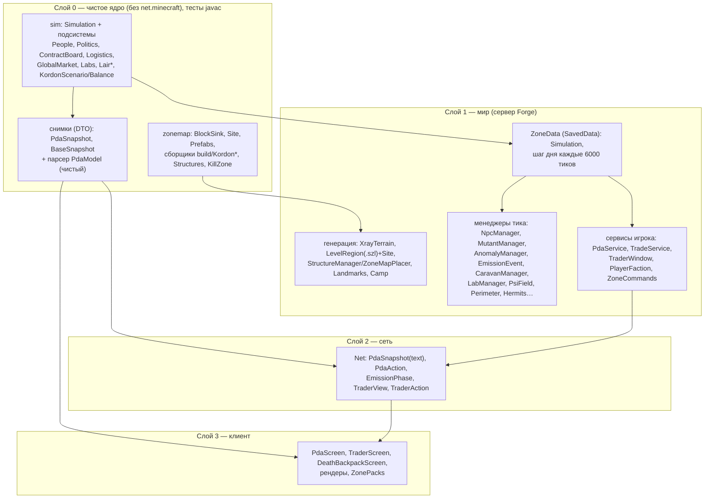

# 04. Целевая архитектура (Team Lead, Fable 5.1, черновик 13.11.2026)

Точка отсчёта: main `7aa3e12` (07.11.2026). Документ опирается на собственный разбор кода руководителем и на отчёты `01-tech-audit.md`, `02-systems-audit.md`, `03-qa-audit.md` (ссылки в тексте); факты, на которые он опирается, прошли независимую проверку QA (T4, `03-qa-audit.md` §8). Статус: **согласованная версия 13.11.2026**; решения, которые остаются за пользователем, перечислены в `00-summary.md`.

## 1. Принцип: не переписывать, а закрепить границы
Проект уже имеет правильное ядро: чистая симуляция без Minecraft (`ru.stalkerzone.sim`, `zonemap`), которую CI компилирует отдельным `javac` и гоняет 78 тестами-`main()`. Это главный актив — его сохраняем. Целевая архитектура не меняет стек (Forge 47.3.0, Java 17, mojmap, TaCZ через отражение, FramedBlocks как необязательная зависимость), а делает явными те границы, которые сейчас держатся на соглашениях, и убирает три «серых зоны»: данные, которые считаются, но не доходят до игрока; статические менеджеры мира без общего контракта; документы, которые отстают от кода.

Ориентир на продукт (решения пользователя 05–07.11): **«Малый Кордон» до ж/д моста** с интерфейсами как в MineColonies (`04-interfaces.md`, `07-plan-to-bridge.md`). Всё, что не ведёт к этому, — не в приоритете.

## 2. Слои (как есть → как должно быть)

Проверено по коду: `StalkerZoneMod.onServerTick` (`StalkerZoneMod.java:63-101`) вызывает 10 менеджеров раз в секунду, `PsiField` раз в 2 с и 8 систем каждый тик, шаг симуляции — `TICKS_PER_SIM_DAY = 6000`; `ZoneData` хранит `Simulation` байтами в `SavedData`; `Net.java:27-37` — пять пакетов; КПК передаётся строкой TSV (`sim/PdaSnapshot.build` → `client/PdaModel.parse`); `PdaModel` не импортирует Minecraft (`PdaModel.java:3-4`) — уже чистый класс, но лежит в `client` и в список `tools/ci/test_sources.sh` не входит.

## 3. Целевые модули и их контракты

| Модуль | Содержимое | Контракт наружу | Владелец (роль) | Что меняется против текущего |
|---|---|---|---|---|
| **sim.core** | `Simulation` как агрегат состояния и оркестратор `step()`; подсистемы с единым `daily(sim, rng)` | `step()`, `save()/load()` с версией, `audit()` | Программист | Новые механики — только в подсистемы (`Lair*`, `ContractBoard`, `Logistics`…), не в `Simulation`. Из `Simulation` постепенно выносятся блоки «аномалии/выброс», «логова», «проходы/маршруты», «сделки игрока» (сейчас 2966 строк, около 78 публичных методов — T1-7.5) |
| **sim.scenario** | `KordonScenario`, `KordonBalance`, `Scenarios` | номера узлов (стабильные, только в конец), `ZONE_OUTPOSTS`, `LAIR_SITES` | Программист | Массивы по числу узлов (`RAID_TARGET_WEIGHT = new double[24]`, `COORDS`) — завести одну константу `NODE_COUNT` и тест на согласованность |
| **sim.snapshot** | `PdaSnapshot`, `BaseSnapshot`, `PdaModel` (перенести из `client` или дублировать парсер в чистом пакете) | формат снимка с **номером версии в первой строке**; тест «собрать → разобрать» в чистом javac | Программист | Сейчас парсер клиента молча игнорирует записи `Q`/`U` (отряды, население — карточка 051), а `BaseSnapshot` (052) никем не используется вне `sim`. Тест кругового прохода закрывает это навсегда |
| **zonemap.site** | `Site`, `Prefabs` (`SITES`, `points`, `killZones`), `BlockSink`, `Structures` | `Site(id, node).plateau(...).build(of(CLEAR, X::build))`; метки мест (`guard`, `bed`, `shelter`, `mg`, `kill_line`…) | Программист | Единственный общий файл двух ролей — `Prefabs.SITES` (по одной строке на сборщик). Оставить, но закрепить правило «одна строка — одна регистрация» и тест `PrefabsTest` на пересечение `CLEAR` |
| **zonemap.build** | сборщики `Kordon*`, `Framed`, `Vehicles`, `B` | `CLEAR`, `build(BlockSink, lvl)`, места через `b.mark` | Строитель | Без изменений. Сборщик логова `Prefabs::lairL3` и `Structures.lairDen` живут в файлах Программиста — допустимо, но зафиксировать |
| **world.gen** | `XrayTerrain`, `LevelRegion(s)`, `XrayPlacer`, `ZoneMapPlacer`, `StructureManager`, `Landmarks`, `WorldDecorator`, `Camp` | правило «при `ChunkEvent.Load` блоки только через `ObjPropBlock.safeSet`/`placeInChunk`» (грабли #64, #67, #117) | Программист | Добавить проверку в CI: сервер в CI уже грузит площадки `forceload`-ом (`server_smoke.sh`); добавить тест-сканер сборщиков на блоки с `onPlace`/BlockEntity (см. `08-test-plan.md`) |
| **world.systems** | менеджеры тика | один интерфейс `ServerSystem { tick(server); cadence }` и один список в `StalkerZoneMod` | Программист | Сейчас 19 статических вызовов подряд; интерфейс нужен не ради красоты, а чтобы сторож и профилировщик (`/zone`) могли назвать виновника зависания по имени |
| **world.player** | `PdaService`, `TradeService`, `TraderWindow`, `PlayerFaction`, `survival`, `gear` | сервер авторитетен: клиент только просит (`PdaAction`, `TraderAction`) | Программист | Без изменений |
| **net** | `Net` | пакеты-DTO; строковый TSV для КПК допустим, пока есть тест кругового прохода | Программист | Добавить пакет `BaseView` (пульт базы, П-09) по образцу `TraderView` |
| **client** | экраны, рендеры | только читает снимки | Программист | П-08: карта с отрядами (`Q`), население (`U`); П-09: пульт базы из `BaseSnapshot` |
| **compat** | `Tacz`, `GunQuality`, `GunPackInstaller`, `CompatConfig` | отражение + `szguns_pack` | Программист | Зафиксировать в тесте список имён методов TaCZ, которые ищутся отражением (ломается молча при обновлении TaCZ) |
| **tools** | `tools/xray` (импорт уровней), `tools/prefab` (превью), `tools/ci`, `tools/conveyor`, `tools/notify` | скрипты с README | Программист (ci, conveyor), Строитель (prefab), импорт — отдельная карточка | Без изменений |

## 4. Правила, которые закрепляем (из «граблей» в `SKILL.md` и журналов)
1. `sim` и `zonemap` не импортируют Minecraft — проверяет CI (`test_sources.sh`). Список исходников для чистых тестов — **один** (`test_sources.sh`); `tools/simtest.ps1` должен читать его же, а не свой список (сейчас расходятся: в `.sh` есть `gear/TaczWeight.java`, в `.ps1` нет).
2. Enum-ы, сохраняемые по номеру — все 11 из T1 §3.2 (`Phase`, `Goal`, `LairKind`, `BuildingType`, `AnomalyType`, `Contract.Type`, `Contract.Status`, `Convoy.Kind`, `Person.Cls`, `Person.Role`, `MutantType`), `ArtifactDef` и индекс `Good.ALL` — только дописывать в конец; закрепить одним тестом порядка (сейчас есть только у `ArtifactDef`).
3. Новые узлы — только в конец `KordonScenario`, версия сохранения +1. Для «Малого Кордона» старые сохранения при смене версии пересоздаются (`Simulation.load`: `version < 22 && isKordon → Scenarios.create`), то есть **каждая смена набора узлов = новый мир**. Это осознанно до 1.0; записать в `00-start-here.md`.
4. Закон сохранения — `sim.audit()` после каждого дня (`StalkerZoneMod.java:95-100`), тесты экономики — обязательны для карточек, трогающих деньги/товары.
5. Блоки при загрузке чанка — только через `ObjPropBlock.safeSet`/`placeInChunk`; код «при подходе игрока» не читает незагруженные чанки.
6. Клиентские классы — только за `DistExecutor`/`Dist.CLIENT` (соблюдено: `Net.java`, `ModEvents.Client`; `ZonePacks::addPacks` использует только общие классы — T1 §5).
7. Игровой код не пишет поля симуляции напрямую (`ledger`, `cargo`, `playerBuyFactor`): любое событие мира (гибель человека, мутанта, курьера; сделка; пошлина; контракт) проходит через один шлюз «мир → симуляция», проверяемый чистыми тестами (T1 §8.3). Первый случай — `CaravanManager.java:173-176`.
8. Номер, имя, координаты и площадка узла хранятся в одном месте; остальные места (`Prefabs.NODE_*`, `NodePopulation`, `ContractBoard`, `KordonBalance`, JSON) проверяются тестом согласованности; узлы не ищутся по строке имени (T1 §8.7, T2 §6.1).
9. Карточка конвейера, меняющая поведение мира, содержит пункт «видно в игре: где вызывается» или явную пометку «только данные для задачи П-xx» (T1 §8.9, T2 §6.10) — иначе повторятся 051/052/056/061/064.

## 4а. Что берём из рекомендаций T1 (`01-tech-audit.md` §8) и T2 (`02-systems-audit.md` §6)

| Рекомендация | Решение руководителя | Шаг `07-roadmap.md` |
|---|---|---|
| Ядро как отдельный набор исходников (T1 §8.1, T2 §6.8) | Да, в два шага: сначала один список исходников для CI/Windows/конвейера + тест «класс из теста есть в списке»; перенос `PdaModel`, `ZoneBounds`, `ArtifactDef`, `TaczWeight` в чистый пакет — позже. Отдельный source set Gradle — не сейчас | 0.2, 3.5 |
| Единый API записи при загрузке чанка + обобщённый `ChunkLoadPlaceTest` (T1 §8.2) | Да, приоритет после документов: это закрывает класс P-03 | 0.4, 3.4 |
| Шлюз «мир → симуляция» (T1 §8.3, T2 §6.6) | Да; сначала точечная правка курьера с тестом, затем фасад по мере работ | 0.4, 3.6 |
| Кодек сохранения со стабильными id и эталонным сохранением в тестах (T1 §8.4) | Да, но после интерфейсов; до тех пор — правило «новая версия = новый мир» + тест порядка 11 enum-ов | 0.4, 3.7 |
| Делить `Simulation` по месту работ (T1 §8.5) | Да, по одной подсистеме под готовый тест; логова — первыми (подключить `LairTerritory` к `MutantManager`) | 2.1, 3.1–3.3 |
| Жизненный цикл: один объект состояния на сервер (T1 §8.6) | Да, вместе с интерфейсом `ServerSystem` | 3.4 |
| Единый реестр узлов (T1 §8.7, T2 §6.1) | Да, сразу: класс констант + тест согласованности; удалить `kordon_points.json`/`KordonPoints` — вместе с мёртвым кодом | 0.4, этап 3 |
| Контракт протокола КПК и пульта: тест «собрать → разобрать» (T1 §8.8, T2 §6.4) | Да, до П-08 | 0.4 |
| CI как ворота: `needs: server` для `nightly`, таймауты, полный прогон (T1 §8.9) | Да | 0.2 |
| Судьба уровней построек в мире (T2 §6.2) | **Нужно решение пользователя**: перестраивать площадку при смене уровня (дорого, но даёт MineColonies-подобный рост) или уровни сборщиков объявить тестовыми, `mg` — с уровня 1 | 1.3 |
| `PointKind` и таблица «кто производит — кто потребляет» (T2 §6.5) | Да, при первом изменении меток | 3.5 |
| Декларативная регистрация площадок (T2 §6.7) | Нет, пока: строка в `Prefabs.SITES` — приемлемая цена; тест на потолки вывести из реестра | — |
| Выбор сценария через конфиг вместо системного свойства (T2 §6.9) | Позже: `kordon_war` и `zone` закрепить как тестовые сценарии | этап 4 |
| Оставить как есть: чистая симуляция с тестами-`main`, `BlockSink → Prefabs/Site → PrefabLayer`, сервер как авторитет в торговле, `ServerWatchdog`, `fake_szl.py` + `server_smoke.sh` (T1 §8.10) | Согласен | — |

## 5. Что НЕ делаем (чтобы не распылиться)
- Не делим проект на Gradle-модули, не вводим DI-контейнер, не переводим снимки на JSON/Codec — выигрыша для «Малого Кордона» нет, риск регрессий есть.
- Не трогаем `tools/xray` и формат `.szl` (работает, данные GSC вне репозитория).
- Не переписываем `Simulation` одним махом: вынос подсистем — по одной, под готовый тест (формат карточки конвейера v2 подходит).
- Не создаём новых ролей и документов сверх `docs/claude/`: аудит — временная команда, её результат — эти файлы.

## 6. Вопросы к отчётам участников — закрыты
- T1: других доказанных мест синхронной генерации из тика после #117 нет, остались недоказанные обходы `safeSet` (T1 §4.2); тик дешёв, единственная заметная нагрузка — частицы аномалий (T1 §5).
- T2: только в симуляции живут территории логов, добыча, грызня видов, конвои; пси и лаборатории на Кордоне выключены (T2 §5.1, карточка 024).
- T3/T4: прогон 78 тестов и проверка 49 утверждений — `03-qa-audit.md` §4, §8; сводные документы руководителя проверены отдельно (`09-qa-consolidation-check.md`, 21 правка внесена).
